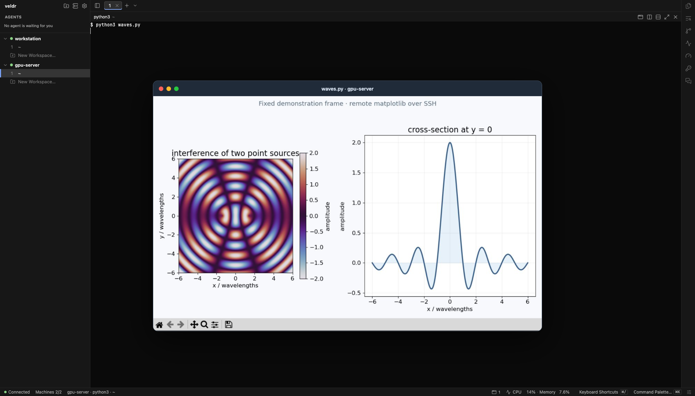

# herdr-ide

English | [简体中文](README.zh-CN.md)

A terminal-first, multi-machine, agent-native web IDE built on the
[herdr-core](https://github.com/herdrdev/herdr-core) terminal core: the
workspaces and terminals of every machine in one browser tab, with VS Code
(code-server) one click away.


## Features

- **Terminals in the browser.** Each machine's terminal core (herdr-core)
  runs the programs; the browser emulates every terminal itself with
  Ghostty's terminal library, compiled to WebAssembly, and draws it with
  WebGL (Canvas 2D without it). Keys are encoded for the program in the
  pane (kitty keyboard protocol included). Mouse, scrollback (selections
  scroll past the edge and copy whole), IME, OSC 52 copy (a selection in
  Claude Code goes straight to the clipboard), resizable splits, and
  programs see the UI theme's colors. Workspaces, tabs and splits are a
  layout document kept on each machine, the same in every browser and the
  desktop app. Drag a pane by its header to swap or move it, click its title to rename it; drag tabs and workspaces to
  reorder them; right-click a pane header, tab or workspace for its
  commands, or a pane's text to copy, paste or open a path. Everything is
  in reach of the mouse; the few default keys take nothing from the
  programs in the terminals (`ctrl+b` reaches tmux), and every key can be
  bound in the settings.
- **Terminal core included.** The binary carries herdr-core for Linux/macOS
  on amd64/arm64 and installs it on a machine the first time its terminals
  are shown; machines need nothing installed and no internet. Programs keep running
  when the browser closes or the core stops. Right-click a machine to
  **Start terminal core**, **Restart terminal core…** (its programs keep
  running) or **Stop terminal core…**.
- **Multi-machine.** Keeps its own list of SSH machines (the machines saved
  in herdr are imported the first time); right-click the sidebar to add one
  (an ssh target and a label; a password or host key is asked for in a
  terminal), or a machine to rename, remove, disable or enable it. One ssh
  connection per machine runs a small static agent
  (linux/macOS × amd64/arm64, uploaded automatically) that multiplexes
  everything; nothing listens on the machines.
- **Agent-native.** An inbox of agents that are blocked or done across all
  machines, browser notifications and sounds when an agent needs input or
  finishes, starting agents from the command palette,
  sending code from VS Code to the focused agent, pasting images into agent
  prompts. Each machine's agent tells which coding agent runs in a terminal
  and whether it works, waits or finished a turn, with herdr's rules for
  Claude Code, Codex, Gemini, OpenCode and more.
- **VS Code on demand.** code-server is installed per machine from the core
  host (no internet needed on machines), downloaded by the machines
  themselves, or taken from an existing install, with Git Graph and a bridge
  extension: open a pane's folder, its diff or Git Graph from the buttons
  in the pane's header or the command palette; jump from a `path:line` in the terminal
  to the editor. Each workspace has its own panel, so several VS Code
  windows stay open and switching workspace switches between them. The
  panel sits beside or below the terminals. Idle instances are stopped.
- **Program windows.** Windows that programs on remote Linux machines open
  (matplotlib, the MuJoCo viewer, Qt tools) appear in browser windows, one
  per program window, with mouse and keyboard. Terminals get a virtual
  display automatically (a shell opened before can be given it from
  its menu); Xvfb is fetched without root when a machine lacks it, and
  VirtualGL renders OpenGL on the GPU where it is installed. Windows that
  keep changing are sent as video (H.264 on NVIDIA, Intel and AMD GPUs, VP8
  otherwise) to browsers that decode it, still ones as exact pictures.
- **Quick Look.** ⌘/Ctrl-click or right-click a path in a terminal, also one
  wrapped over several lines, to preview images, GIFs, videos (with
  seeking), audio, PDFs, text or directories.
- **Formulas.** Rest the pointer on a LaTeX formula an agent wrote in a
  pane (`$…$`, `$$…$$`, `\(…\)`, `\[…\]`, also with the backslashes its
  markdown dropped) to see it typeset, and copy its source.
- **Find.** ⌘F (Ctrl+Shift+F on other systems) finds text in a pane's
  output, scrollback included: every match on the screen is highlighted,
  Enter and Shift+Enter step to older and newer ones, scrolling them into
  view.
- **Files to agents.** Paste or drop files into a pane to paste their paths;
  files that are not on the pane's machine are uploaded to it first, dropped
  ones into the pane's directory (an existing file there is never replaced).
  The uploads panel in the status bar shows each upload's progress and
  speed, cancels uploads and lists the recent ones.
- **Files from machines.** Right-click in a pane to download the path under
  the pointer, or choose files and folders of the pane's directory to
  download together; folders arrive as zip archives, streamed from the
  machine. VS Code's explorer has the same download. The downloads panel in
  the status bar shows each download's progress, speed and result, and
  cancels or repeats it.
- **Several browsers at once.** Every browser and the desktop app show the
  same terminals and type into them; the one used last sets a terminal's
  size.
- **Settings.** Language (English, Chinese), light/dark theme followed by
  VS Code, interface size, the terminals' font, line height, cursor,
  scrollback, bell and colors (both themes' 16 colors), panel position, the
  code-server installation method and every keyboard shortcut, in one
  dialog (the sidebar's gear, `cmd+,` in the desktop app) with search. Settings and keys are kept on the core's
  host in two JSON files you can also edit by hand, and are the same in
  every browser and the desktop app. Terminals use
  the included JetBrains Mono font unless you choose another.

## Screenshots

**VS Code beside the terminals.** An agent's `path:line` opens in VS Code
on the machine where the pane runs; the pane header opens its folder, its
diff or Git Graph.


**Program windows.** A matplotlib window on a remote Linux machine opens in
a browser window of its own, with mouse and keyboard.



**Quick Look.** Right-click or ⌘/Ctrl-click a path in a terminal to preview
it; the arrows step through the other files of the folder.


## Quick start

Requirements:

- an OpenSSH client with working access to the machines you want to use
  (this host needs none);
- to build: Go (version in `go.mod`), Node.js 22.12+ and pnpm (`corepack enable`
  picks the pinned version).

```bash
make deps && make build
cd dist/packages/herdr-ide-$(go env GOOS)-$(go env GOARCH)
./herdr-ide
```

Or extract the matching archive from `dist/release/` (or GitHub Releases)
and run `./herdr-ide`. Add SSH machines with **Add machine…** in the
sidebar. Coming from a version that drew its panes from herdr: settings,
keys and machines move over on the first start, terminals stay in herdr
([migration](docs/deployment.md#migrating-from-versions-that-used-herdr)).

Open <http://127.0.0.1:7780>. The status bar opens the command palette and
the list of shortcuts (`cmd+k` and `cmd+/` in a browser on macOS,
`ctrl+shift+/` for the shortcuts elsewhere). All flags are listed in
[docs/reference.md](docs/reference.md).

## macOS desktop app

On macOS, download the DMG for your Mac from GitHub Releases
(`…-mac-arm64.dmg` for Apple Silicon, `…-mac-x64.dmg` for Intel) and drag
the app to Applications. It is not notarized, so allow the first launch under
System Settings → Privacy & Security. Or build the Electron app, with the
same embedded core, UI, agents and VS Code bridge, yourself:

```bash
make desktop-app                 # .app in dist/desktop/mac[-arm64]/
make desktop-dmg                 # .app plus a drag-to-Applications .dmg
make desktop-install             # .app, copied into /Applications
ARCH=x64 make desktop-dmg        # Intel; default is the host Node architecture
```

The desktop and browser share a terminal-pane icon, with a multi-resolution
macOS version for Finder and the Dock.

Drag folders from Finder onto the sidebar or the app's Dock icon to create a
workspace for each on the local machine. Files and folders dropped on a pane
of the local machine are pasted as their own paths, without uploading.

In the app, `cmd+t` opens a tab, `cmd+w` closes the pane, `cmd+d` /
`cmd+shift+d` split it, `cmd+n` creates a workspace, `cmd+,` opens the
settings, `cmd+shift+p` the command palette and `cmd+j` shows or hides the
VS Code panel; while VS Code has focus, its own keys come first. The menu
bar shows the keys in effect, in the UI's language; the title bar follows
the UI's theme.
Change or remove the keys under **Settings → Keyboard shortcuts**, where
chords such as `ctrl+b c` can be bound too; browsers keep their own
`cmd+t` / `cmd+w`.

The Electron app starts its own core at `http://127.0.0.1:7781` with
instance `desktop`; quitting or closing the main window stops that core. OpenSSH
must already be installed. Released and local builds use ad-hoc signing,
without Apple notarization or automatic updates. See
[desktop deployment](docs/deployment.md#macos-desktop-app) for paths,
versioning and isolated development. Only macOS packaging is implemented.

## Remote access

herdr-ide has no login of its own: keep it on `127.0.0.1` and put an
authenticating reverse proxy with HTTPS in front (Tailscale, Caddy, nginx), then
pass its origin with `--allowed-origin`. Optional guardrails: a proxy secret
header, a read-only mode and an audit log. See
[docs/deployment.md](docs/deployment.md) and [SECURITY.md](SECURITY.md).

## Air-gapped networks

Machines never download anything. If the host running herdr-ide is offline
too, run `herdr-ide fetch-assets DIR` on a connected machine, carry `DIR` over
and start with `--offline --seed-dir DIR`. Downloads are verified against
pinned SHA-256 digests. Details in
[docs/deployment.md](docs/deployment.md#air-gapped-networks).

## Documentation

- [docs/reference.md](docs/reference.md) – flags, shortcuts, environment, files
- [docs/deployment.md](docs/deployment.md) – reverse proxies, air-gapped installs, remote resources, services
- [docs/architecture.md](docs/architecture.md) – components and protocols
- [docs/features/](docs/features/README.md) – one design document per feature, with the alternatives considered
- [SECURITY.md](SECURITY.md) – threat model and reporting

## Development

```bash
make dev-core      # core on :7790 with --instance dev (terminal core session herdr-ide-dev)
make dev-web       # UI with hot reload on :5173
make check test    # before sending a PR
```

See [CONTRIBUTING.md](CONTRIBUTING.md); coding agents start with
[AGENTS.md](AGENTS.md).

## Contributing

Issues and pull requests are welcome, in English or Chinese. Please read
[CONTRIBUTING.md](CONTRIBUTING.md) and the
[Code of Conduct](CODE_OF_CONDUCT.md) first.

## License

[MIT](LICENSE). Third-party licenses: [THIRD_PARTY_NOTICES.md](THIRD_PARTY_NOTICES.md)
(Go modules) and `/licenses.md` served by the binary (the web UI bundle,
with Ghostty's terminal library (MIT), KaTeX and the JetBrains Mono font).
The core embeds
[herdr-core](https://github.com/herdrdev/herdr-core) (Apache-2.0) for
machines; release archives carry its license and notices in
`licenses/herdr-core/`. The agents carry herdr's agent detection rules
(Apache-2.0, [licenses/herdr-detect/](licenses/herdr-detect/)), and the
core the video encoder for Linux machines (FFmpeg, LGPL-2.1, with libvpx,
libva and libdrm; [licenses/encoder/](licenses/encoder/)).
code-server and Git Graph retain their own licenses and are downloaded at
runtime. Git Graph restricts derivative distribution and does not clearly
grant general redistribution of the original; it is excluded from public
release packages.
