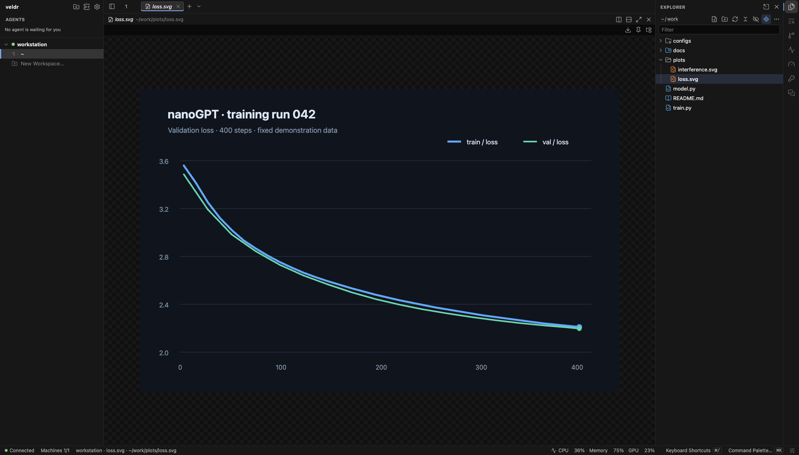

# veldr

English | [简体中文](README.zh-CN.md)

A terminal-first, multi-machine, agent-native web IDE built on the
[herdr-core](https://github.com/herdrdev/herdr-core) terminal core: the
workspaces and terminals of every machine in one browser tab, with VS Code
(code-server) one click away.


## Features

- **Terminals in the browser.** Ghostty's terminal library, compiled to
  WebAssembly, emulates each terminal; WebGL draws it. Keys are encoded
  for the program in the pane (kitty keyboard protocol included), with
  mouse, IME, scrollback and OSC 52 copy.
- **Workspaces, tabs and splits.** A layout document kept on each machine,
  the same in every browser and the desktop app. Drag, rename, pin, split
  and reorder with the mouse; right-click anything for its commands. A
  pinned tab stays first and `cmd+w` does not close it.
- **Keys left to the programs.** The few default keys take almost nothing
  from the terminals; `ctrl+b` moves the keyboard from an editor to its
  pane header and back, and stays the program's (tmux) in a terminal. Every key can be rebound or unbound, chords included.
- **Terminal core included.** herdr-core is installed on a machine the
  first time its terminals are shown; machines need nothing installed and
  no internet. Programs keep running when the browser or the core stops.
- **Workspaces come back.** After a machine restarts, its tabs return as
  shells in their directories, and Claude Code and Codex resume the
  session each ran (`claude --resume <id>`, `codex resume <id>`) once the
  machine confirms it, else the directory's latest conversation
  ([33](docs/features/33-workspace-restore.md)).
- **Multi-machine.** Add any host of `~/.ssh/config` or any ssh target.
  One ssh connection per machine runs a small static agent that
  multiplexes everything; nothing listens on the machines.
  Cluster nodes sharing one home directory (NFS) stay separate machines,
  each with its own sockets, terminal core and files
  ([40](docs/features/40-shared-homes.md)).
- **Agent-native.** An inbox of agents that are blocked or done on every
  machine, with notifications and sounds. Each machine detects Claude
  Code, Codex, Gemini, OpenCode and more, whether they work, wait or
  finished, and which session Claude Code and Codex run
  ([35](docs/features/35-agent-native-view.md)).
- **Agent chats.** A tab can be a chat with Claude Code, Codex, Kimi Code
  or Grok running headless on any machine: streamed text, permissions,
  questions and plans answered in cards, model, effort and mode per chat
  (full access only where the machine allows it), images, queued messages,
  and cost, context and limits. A chat host on each machine keeps chats
  across disconnects within limits you set and stops idle agents; chats
  count in the agent inbox. A session moves between a terminal and a chat
  either way ([37](docs/features/37-agent-chats.md)).
- **Terminal history.** Opt in per machine (terminal output can hold
  secrets) and the machine keeps bounded snapshots of its terminals'
  output; after its terminal core restarts, each terminal shows its old
  output above the new shell ([36](docs/features/36-terminal-history.md)).
- **VS Code on demand.** code-server per machine, installed from the core
  host without internet on the machines, as a pane beside the terminals;
  a `path:line` in a terminal opens there. Off by default, because its
  extensions run with the UI's own origin.
- **Program windows.** Windows of programs on remote Linux machines
  (matplotlib, MuJoCo, Isaac Sim) open in browser windows, drawn on the
  GPU where there is one and streamed as video while they change.
- **Quick Look.** ⌘/Ctrl-click or right-click a path in a terminal to
  preview images, video, audio, PDFs, code (about 125 languages), Markdown
  or directories.
- **Formulas.** Rest the pointer on a LaTeX formula an agent printed to
  see it typeset and copy its source.
- **Find.** ⌘F (Ctrl+Shift+F elsewhere) finds text in a pane's output,
  scrollback included.
- **Files to and from machines.** Paste or drop files into a pane to
  upload them and paste their paths; download any path, folders as zip
  archives. The status bar shows the transfers' progress.
- **Several browsers at once.** Every browser and the desktop app show
  and type into the same terminals.
- **Plugins and the right sidebar.** Features that come as plugins add
  panels, panes, commands and status bar items; each can be turned off in
  Settings › Plugins.
- **File explorer.** A tree of the machine's files that follows the
  focused terminal, used as VS Code's explorer, and an editor whose saves
  never overwrite a change made on the machine
  ([28](docs/features/28-file-explorer.md)).
- **Browser.** A tab shows a machine's `localhost` service through a port
  forward, as `ssh -L` would; forwards are made only when you open them
  ([32](docs/features/32-browser-and-ports.md)).
- **Git.** VS Code's Source Control and Git Graph without VS Code, for the
  focused pane's repository on any machine: stage ranges, commit, branch,
  pull and push ([31](docs/features/31-git.md)).
- **System monitor and task manager.** CPU, memory, GPUs, network and
  disks of each machine, hardware temperatures and fan speeds, and a
  process tree with guarded signals
  ([34](docs/features/34-system-monitor.md)).
- **Project search.** A Search panel finds text in the files of a folder
  on any machine, as VS Code's search view: match case, whole word,
  regular expressions, include and exclude globs; a click opens the match.
  ripgrep where the machine has it, a bounded search of its own otherwise
  ([41](docs/features/41-project-search.md)).
- **Variable vault.** API keys encrypted under your passphrase on the core's
  computer, read by coding agents on every machine through an MCP server;
  each read is allowed per machine or approved by you, with the passphrase
  or Touch ID, Windows Hello or a WebAuthn credential
  ([30](docs/features/30-variable-vault.md)).
- **AI usage.** What the AI subscriptions signed in on your machines have
  left (Claude, Codex, Grok, Antigravity, Kimi Code, DeepSeek), with
  alerts, the local logs' cost at API prices, and what the focused Claude
  Code or Codex session has cost so far
  ([29](docs/features/29-ai-usage.md)).
- **Settings.** Language (English, Chinese), themes, terminal font and
  colors, notifications and every shortcut, in one searchable dialog laid
  out as VS Code's. Kept on the core's host in two JSON files you can
  also edit by hand ([13](docs/features/13-settings-and-appearance.md)).

## Screenshots

**VS Code beside the terminals.** An agent's `path:line` opens in VS Code
on the machine where the pane runs; the pane header opens its folder, its
diff or Git Graph.


**Program windows.** A matplotlib window on a remote Linux machine opens in
a browser window of its own, with mouse and keyboard.


**Quick Look.** Right-click or ⌘/Ctrl-click a path in a terminal to preview
it; the arrows step through the other files of the folder.



## Quick start

Requirements:

- an OpenSSH client with working access to the machines you want to use
  (this host needs none);
- to build: Bun 1.4.5 (the core), Go (version in `go.mod`; the machine
  builds), Node.js 22.12+ and pnpm (`corepack enable` picks the pinned
  version).

```bash
make deps && make build
cd dist/packages/veldr-$(go env GOOS)-$(go env GOARCH)
./veldr
```

Or extract the matching archive from `dist/release/` (or GitHub Releases)
and run `./veldr`. Add SSH machines with **Add machine…** in the
sidebar.

Open <http://127.0.0.1:7780>. The status bar opens the command palette and
the list of shortcuts. All flags are listed in
[docs/reference.md](docs/reference.md).

## Desktop app

The same UI in an Electron app with a core of its own, which runs inside the
app and listens on no port (instance `desktop`), for macOS, Windows and Linux.
Download it from GitHub Releases:

| | macOS | Windows | Linux |
| --- | --- | --- | --- |
| Packages | `…-mac-arm64.dmg` (Apple Silicon), `…-mac-x64.dmg` (Intel), also as `.zip` | `…-win-x64.exe`, a setup for your user (no administrator) | `…-linux-amd64.deb`, `…-linux-arm64.deb`, `…-linux-x86_64.AppImage`, `…-linux-arm64.AppImage` |
| Signing | ad hoc, unless the release was built with a Developer ID (then notarized) | none | none |
| Local terminals | yes | no: the local machine needs Linux or macOS | yes |
| SSH machines | yes | yes, with key authentication | yes |
| VS Code | every machine | SSH machines | every machine |
| Program windows | of remote Linux machines | of remote Linux machines | of remote Linux machines |
| Notifications | yes, with a badge on the Dock icon | yes, with an overlay on the taskbar button | with a notification daemon (desktop environments run one) |

- **macOS:** drag the app from the DMG to Applications. If macOS says it
  cannot check the app for malicious software, Control-click the app and
  choose **Open** (on macOS 15 and later: **Open Anyway** under System
  Settings → Privacy & Security). For terminals to open Desktop,
  Documents, Downloads or external disks without asking, grant Full Disk
  Access under **Settings → Terminal → Permissions**; an app signed ad hoc
  needs it again after each update.
- **Windows:** run the setup; if SmartScreen says "Windows protected your
  PC", choose **More info** → **Run anyway**. The app needs Windows'
  OpenSSH Client and works on SSH machines only: accept each host key once
  with `ssh <target>` and use a key the ssh agent holds (`ssh-add`), since
  the app cannot ask for a password.
- **Linux:** `sudo apt install ./veldr-<version>-linux-amd64.deb`
  (Ubuntu 24.04 and later need the deb, which lets Chromium's sandbox run).
  The AppImage needs `chmod +x` and FUSE 2 (`libfuse2`, `libfuse2t64` on
  Ubuntu 24.04).

There are no automatic updates: install a newer release over the old one.
Or build the app for the system you are on:

```bash
make desktop-app                 # the unpacked app in dist/desktop/
make desktop-dist                # this system's installers: DMG and zip, setup, or AppImage and deb
make desktop-install             # macOS: the .app, copied into /Applications
ARCH=x64 make desktop-dist       # another architecture; default is the host Node architecture
```

Drag folders onto the sidebar or the Dock icon to create a workspace for
each on the local machine. The app's shortcuts are direct keys
(`cmd+t`, `cmd+w`, `cmd+d` on macOS; `ctrl+shift+t`, `ctrl+shift+w` on
Windows and Linux); every other key, `ctrl+c` included, reaches the
terminal. The full list is in
[docs/reference.md](docs/reference.md#keyboard-shortcuts); change keys
under **Settings → Keyboard Shortcuts**.

Quitting the app stops its core; the machines' terminals keep running. See
[desktop deployment](docs/deployment.md#desktop-app) for paths, versioning
and isolated development.

## Remote access

veldr has no login of its own: keep it on `127.0.0.1` and put an
authenticating reverse proxy with HTTPS in front (Tailscale, Caddy, nginx), then
pass its origin with `--allowed-origin`. Optional guardrails: a proxy secret
header, a read-only mode and an audit log. See
[docs/deployment.md](docs/deployment.md) and [SECURITY.md](SECURITY.md).

## Air-gapped networks

Machines never download anything (the AI usage plugin asks the AI
providers' hosts from the machines whose CLIs are signed in to them; it
fails quietly without internet). If the host running veldr is offline
too, run `veldr fetch-assets DIR` on a connected machine, carry `DIR` over
and start with `--offline --seed-dir DIR`. Downloads are verified against
pinned SHA-256 digests. Details in
[docs/deployment.md](docs/deployment.md#air-gapped-networks).

## Documentation

- [docs/reference.md](docs/reference.md) – flags, shortcuts, environment, files
- [docs/deployment.md](docs/deployment.md) – reverse proxies, air-gapped installs, remote resources, services
- [docs/architecture.md](docs/architecture.md) – components and protocols
- [docs/features/](docs/features/README.md) – one design document per feature, with the alternatives considered
- [SECURITY.md](SECURITY.md) – threat model and reporting

## Development

```bash
make dev-core      # core on :7790 with --instance dev (terminal core session veldr-dev-<host id>)
make dev-web       # UI with hot reload on :5173
make check test    # before sending a PR
```

See [CONTRIBUTING.md](CONTRIBUTING.md); coding agents start with
[AGENTS.md](AGENTS.md).

## Contributing

Issues and pull requests are welcome, in English or Chinese. Please read
[CONTRIBUTING.md](CONTRIBUTING.md) and the
[Code of Conduct](CODE_OF_CONDUCT.md) first.

## License

[MIT](LICENSE). Third-party licenses: [THIRD_PARTY_NOTICES.md](THIRD_PARTY_NOTICES.md)
(the core's Bun runtime and npm packages, the machine builds' Go modules)
and `/licenses.md` served by the core (the web UI bundle,
with Ghostty's terminal library (MIT), KaTeX and the JetBrains Mono font).
The core embeds
[herdr-core](https://github.com/herdrdev/herdr-core) (Apache-2.0) for
machines; release archives carry its license and notices in
`licenses/herdr-core/`. The agents carry herdr's agent detection rules
(Apache-2.0, [licenses/herdr-detect/](licenses/herdr-detect/)), and the
core the video encoder for Linux machines (FFmpeg, LGPL-2.1, with libvpx,
libva and libdrm; [licenses/encoder/](licenses/encoder/)).
code-server and Git Graph retain their own licenses and are downloaded at
runtime. Git Graph restricts derivative distribution and does not clearly
grant general redistribution of the original; it is excluded from public
release packages.
