# veldr

English | [简体中文](README.zh-CN.md)

A terminal-first, multi-machine, agent-native web IDE built on the [herdr-core](https://github.com/herdrdev/herdr-core) terminal core: the workspaces and terminals of every machine in one browser tab, with VS Code (code-server) one click away.


## Features

- **Terminals in the browser.** Ghostty's terminal library, compiled to WebAssembly, emulates each terminal; WebGL draws it. Keys are encoded for the program in the pane (kitty keyboard protocol included), with mouse, IME, scrollback and OSC 52 copy.
- **Workspaces, tabs and splits.** A layout document kept on each machine, the same in every browser and the desktop app. Drag, rename, pin, split and reorder with the mouse, or detach a tab into its own standalone window and dock it back without interrupting it; right-click anything for its commands. A pinned tab stays first and `cmd+w` does not close it.
- **Keys left to the programs.** The few default keys take almost nothing from the terminals; `ctrl+b` moves the keyboard from an editor to its pane header and back, and stays the program's (tmux) in a terminal. Every key can be rebound or unbound, chords included.
- **Terminal core included.** herdr-core is installed on a machine the first time its terminals are shown; machines need nothing installed and no internet. Programs keep running when the browser or the hub stops.
- **Workspaces come back.** After a machine restarts, its tabs return as shells in their directories, and Claude Code, Codex and Antigravity resume the session each ran (`claude --resume <id>`, `codex resume <id>`, `agy --resume <id>`) once the machine confirms it, else the directory's latest conversation ([33](docs/features/33-workspace-restore.md)).
- **Multi-machine.** Add any host of `~/.ssh/config` or any ssh target. One ssh connection per machine runs a small static agent that multiplexes everything; nothing listens on the machines. Cluster nodes sharing one home directory (NFS) stay separate machines, each with its own sockets, terminal core and files ([40](docs/features/40-shared-homes.md)).
- **Agent-native.** An inbox of agents that are blocked or done on every machine, with notifications and sounds. Each machine detects Claude Code, Codex, Antigravity, Gemini, OpenCode and more, whether they work, wait or finished, and which session Claude Code, Codex and Antigravity run, showing live context usage in the status bar ([35](docs/features/35-agent-native-view.md)).
- **Agent chats.** A tab can be a chat with Claude Code, Codex, Antigravity (ACP), Kimi Code or Grok running headless on any machine: streamed text, permissions, questions and plans answered in cards, per-provider model filtering and start model (a fixed model or the last one chosen), effort and mode per chat (full access only where the machine allows it), images, recursive `@` files and a file picker, Markdown composer editing and preview, per-message queuing with withdraw and explicit steer/interrupt, session fork, rewind and switch-agent handoff, background task and subagent controls, and click-to-compact context usage and cost. A chat host on each machine keeps chats across disconnects within limits you set and stops idle agents; chats count in the agent inbox. A session moves between a terminal and a chat either way ([37](docs/features/37-agent-chats.md)).
- **Terminal history.** Opt in per machine (terminal output can hold secrets) and the machine keeps bounded snapshots of its terminals' output; after its terminal core restarts, each terminal shows its old output above the new shell ([36](docs/features/36-terminal-history.md)).
- **VS Code on demand.** code-server per machine, installed from the hub host without internet on the machines, as a pane beside the terminals; terminal `path:line` links open in the file explorer's preview editor by default, or in VS Code when `files.openLinks` is set to `vscode`. Off by default, because its extensions run with the UI's own origin.
- **Program windows.** Windows of programs on remote Linux machines (matplotlib, MuJoCo, Isaac Sim) open in browser windows, drawn on the GPU where there is one and streamed as video while they change.
- **Quick Look.** ⌘/Ctrl-click or right-click a path in a terminal to preview images, video, audio, PDFs, code (about 125 languages) or Markdown beside it; a folder opens in the File Explorer's tree.
- **Formulas.** Rest the pointer on a LaTeX formula an agent printed to see it typeset and copy its source.
- **Find.** ⌘F (Ctrl+Shift+F elsewhere) finds text in a pane's output, scrollback included.
- **Files to and from machines.** Paste or drop files into a pane to upload them and paste their paths; download any path, folders as zip archives. The status bar shows the transfers' progress.
- **Several browsers at once.** Every browser and the desktop app show and type into the same terminals.
- **Plugins and the right sidebar.** Features that come as plugins add panels, panes, commands and status bar items; each can be turned off in Settings › Plugins, and right-rail panel icons can be reordered by dragging or hidden per browser; hold Cmd (Alt on Windows and Linux) and swipe up or down to switch between them.
- **File explorer.** A tree of the machine's files that follows the focused terminal, with a whole-project filename filter (regular expressions included); drag rows onto a terminal to paste their paths or onto a chat to attach them; and an editor with Markdown Preview/Split/Source modes whose saves never overwrite a change made on the machine ([28](docs/features/28-file-explorer.md)).
- **Browser.** A tab shows a machine's `localhost` service through a port forward, as `ssh -L` would; forwards are made only when you open them ([32](docs/features/32-browser-and-ports.md)).
- **Git.** VS Code's Source Control and Git Graph without VS Code, for the focused pane's repository on any machine: stage ranges, commit, branch, pull and push ([31](docs/features/31-git.md)).
- **System monitor and task manager.** CPU, memory, GPUs, network and disks of each machine, hardware temperatures and fan speeds, and a process tree with guarded signals ([34](docs/features/34-system-monitor.md)).
- **Project search.** A Search panel finds text in the files of a folder on any machine, as VS Code's search view: match case, whole word, regular expressions, include and exclude globs; a click opens the match. ripgrep where the machine has it, a bounded search of its own otherwise ([41](docs/features/41-project-search.md)).
- **Variable vault.** API keys encrypted under your passphrase on the hub's computer, organized into groups and reusable presets: read by coding agents on every machine through an MCP server (allowed per machine or approved with your passphrase, Touch ID, Windows Hello or a WebAuthn credential), or injected opt-in into new terminals and chats of linked workspaces while unlocked ([30](docs/features/30-variable-vault.md)).
- **AI usage.** What the AI subscriptions signed in on your machines have left (Claude, Codex, Grok, Antigravity, Kimi Code, DeepSeek) with value-weighted multi-account merging and alerts, the local logs' cost at API prices, and what the focused coding agent session has cost so far ([29](docs/features/29-ai-usage.md)).
- **Settings.** Language (English, Chinese), themes, terminal font and colors, notifications and every shortcut, in one searchable dialog laid out as VS Code's. Kept on the hub's host in two JSON files you can also edit by hand ([13](docs/features/13-settings-and-appearance.md)).

## Screenshots

Click a screenshot to see it at full size.

<table>
  <tr>
    <td width="50%" valign="top">
      <a href="docs/images/vscode.png">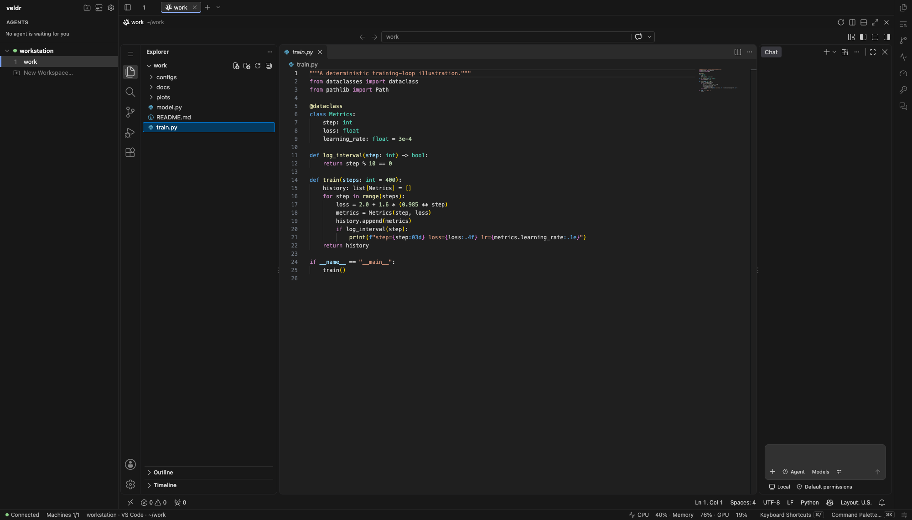</a>
      <br><b>VS Code beside the terminals.</b> Open an agent's <code>path:line</code> in VS Code on the machine where the pane runs (when <code>files.openLinks</code> is <code>vscode</code>); the pane header opens its folder, its diff or Git Graph.
    </td>
    <td width="50%" valign="top">
      <a href="docs/images/windows.png"></a>
      <br><b>Program windows.</b> A matplotlib window on a remote Linux machine opens in a browser window of its own, with mouse and keyboard.
    </td>
  </tr>
  <tr>
    <td width="50%" valign="top">
      <a href="docs/images/quicklook.png"></a>
      <br><b>Quick Look.</b> Preview images, video, audio, PDFs, code, Markdown or directories without leaving the workspace.
    </td>
    <td width="50%" valign="top">
      <a href="docs/images/chat.png">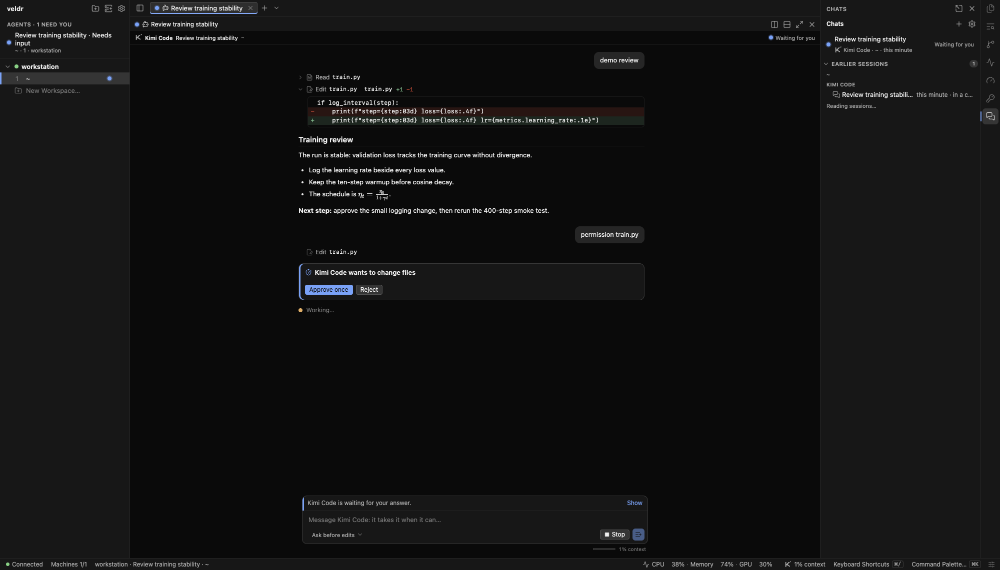</a>
      <br><b>Agent chats.</b> Headless agents stream Markdown, formulas, tool results and diffs into the same layout as the terminals, with permissions answered in cards.
    </td>
  </tr>
  <tr>
    <td width="50%" valign="top">
      <a href="docs/images/files.png">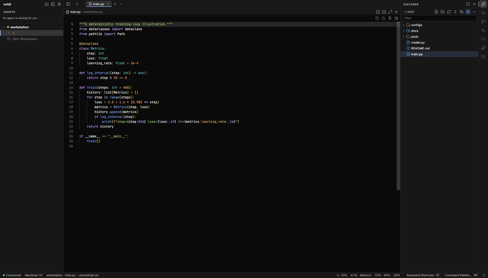</a>
      <br><b>File explorer.</b> Follow the focused terminal's directory and edit code with conflict-safe saves.
    </td>
    <td width="50%" valign="top">
      <a href="docs/images/git.png">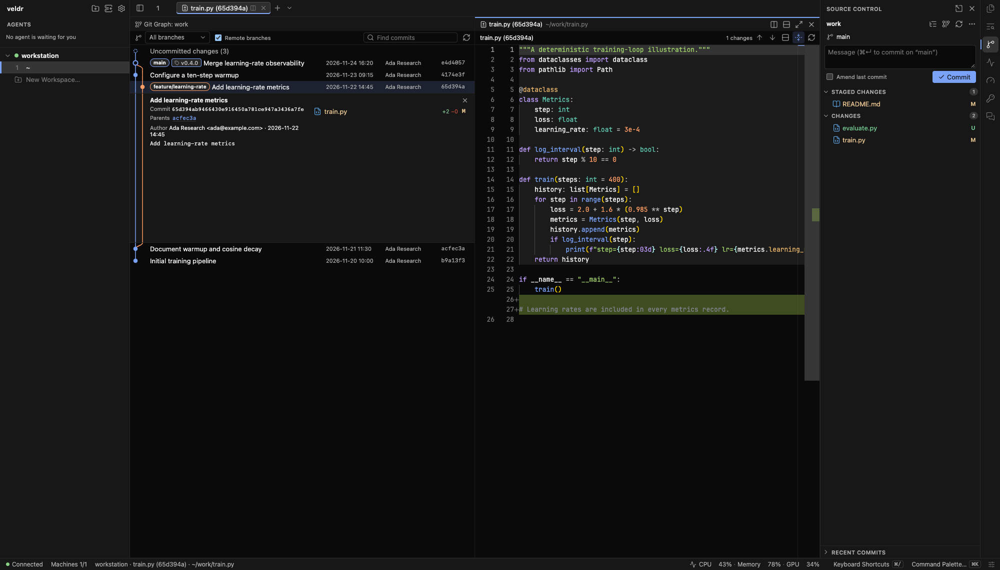</a>
      <br><b>Git.</b> Source Control, a branch and tag graph, and Monaco diffs work without VS Code.
    </td>
  </tr>
  <tr>
    <td width="50%" valign="top">
      <a href="docs/images/monitor.png">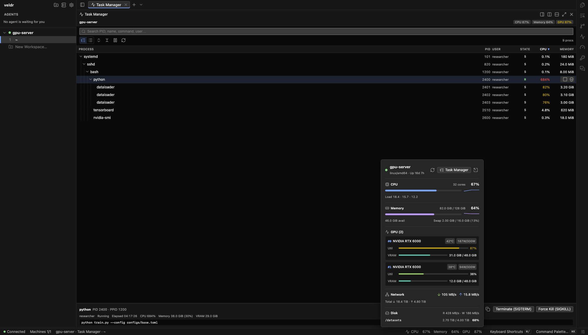</a>
      <br><b>System monitor and task manager.</b> Live machine resources and a searchable process tree share a pane.
    </td>
    <td width="50%" valign="top">
      <a href="docs/images/settings.png">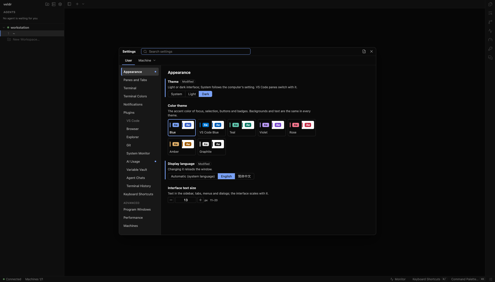</a>
      <br><b>Settings.</b> Search settings, choose appearance and themes, and configure plugins and keybindings.
    </td>
  </tr>
  <tr>
    <td width="50%" valign="top">
      <a href="docs/images/security.png">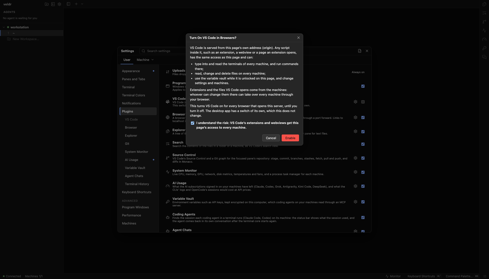</a>
      <br><b>Explicit browser security.</b> Enabling VS Code in a browser requires acknowledging what its extensions and webviews can access.
    </td>
    <td width="50%" valign="top">
      <a href="docs/images/browser.png">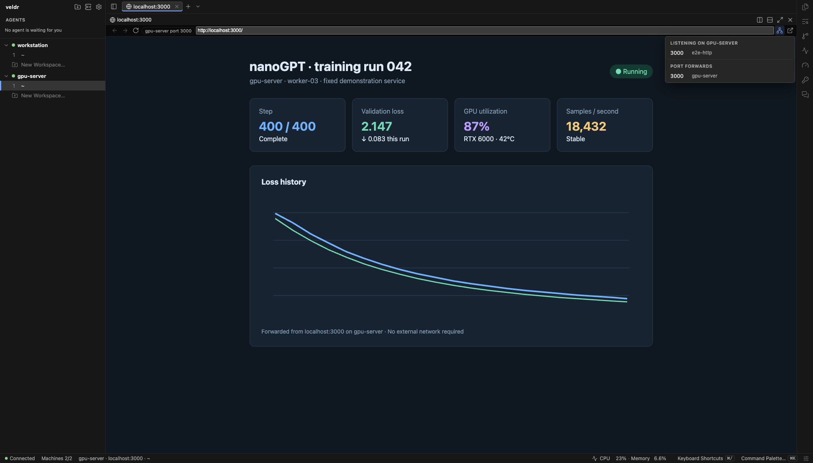</a>
      <br><b>Browser and port forwards.</b> Open a machine's localhost service through a loopback forward and inspect its listening and forwarded ports.
    </td>
  </tr>
  <tr>
    <td width="50%" valign="top">
      <a href="docs/images/search.png">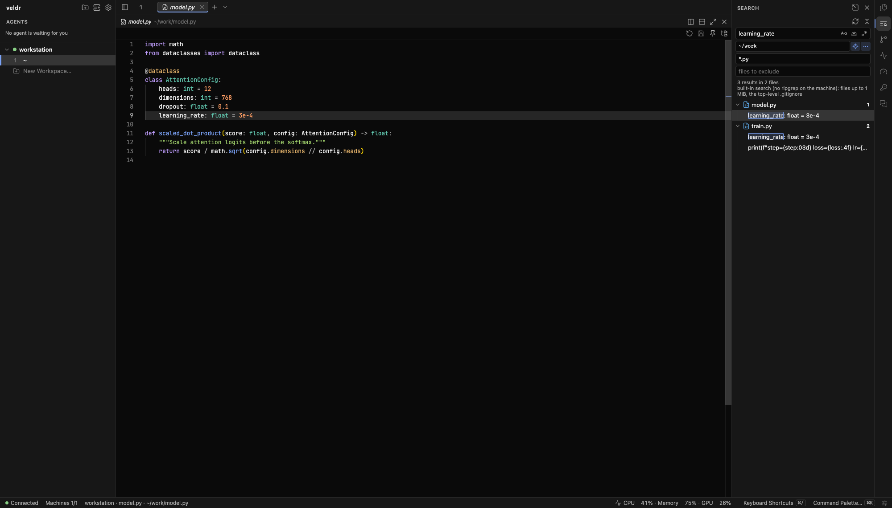</a>
      <br><b>Project search.</b> Search with filters and open a match in the editor.
    </td>
    <td width="50%" valign="top">
      <a href="docs/images/vault.png">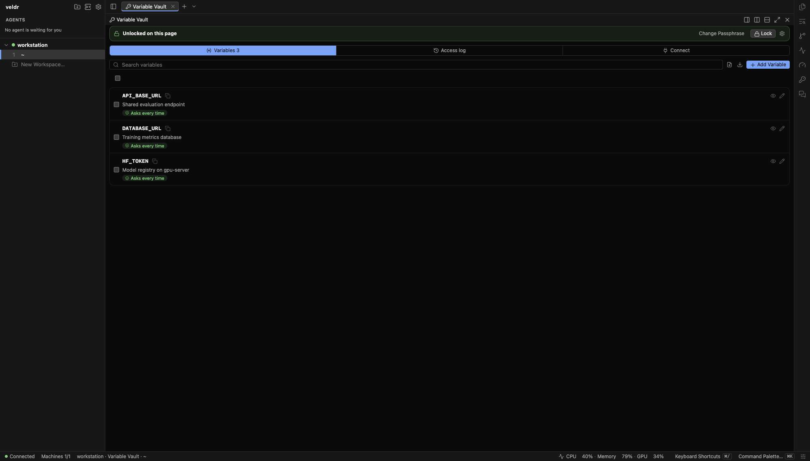</a>
      <br><b>Variable vault.</b> Keep encrypted variables with per-machine access while their values stay hidden.
    </td>
  </tr>
  <tr>
    <td width="50%" valign="top">
      <a href="docs/images/usage.png">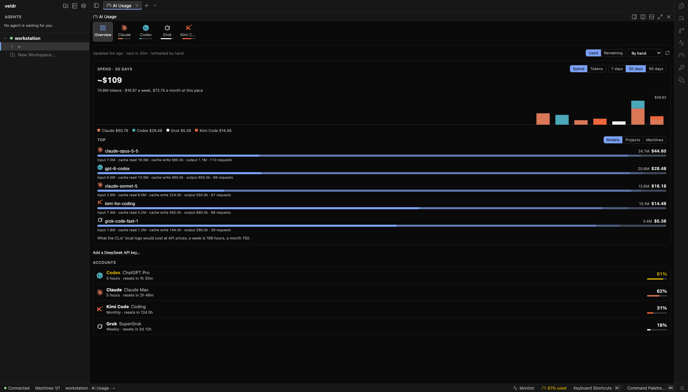</a>
      <br><b>AI usage.</b> Compare subscription windows, resets, balances and API-equivalent spend across providers and machines.
    </td>
    <td width="50%" valign="top">
      <a href="docs/images/terminal-history.png">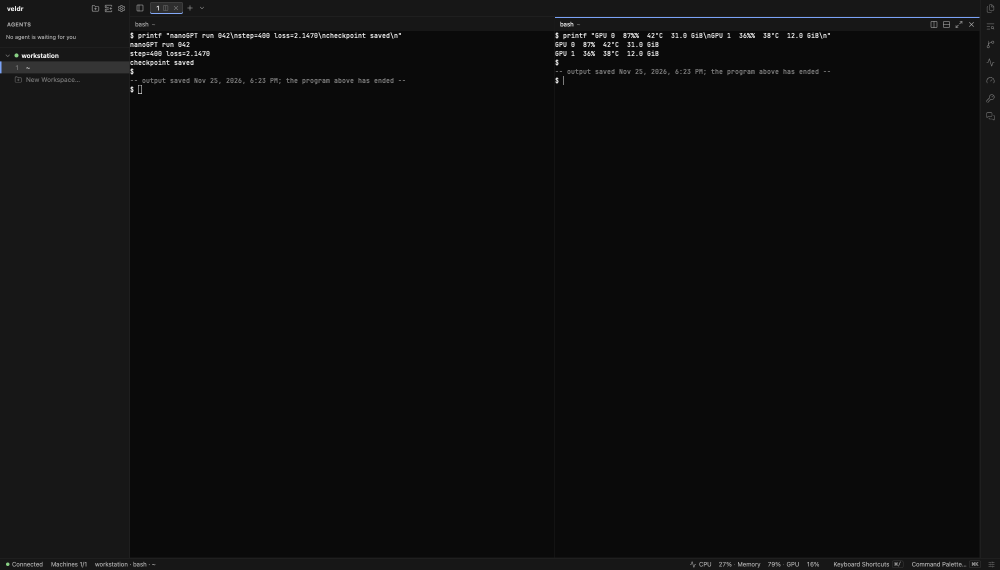</a>
      <br><b>Terminal history.</b> Restored workspaces keep their split layout and show saved output above each new shell.
    </td>
  </tr>
  <tr>
    <td width="50%" valign="top">
      <a href="docs/images/formula.png">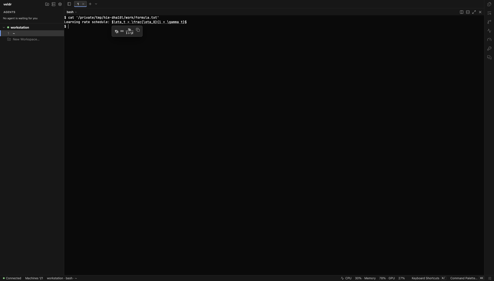</a>
      <br><b>Formulas.</b> Rest the pointer on a LaTeX formula in a terminal to see it typeset and copy its source.
    </td>
    <td width="50%" valign="top">
      <a href="docs/images/desktop.png">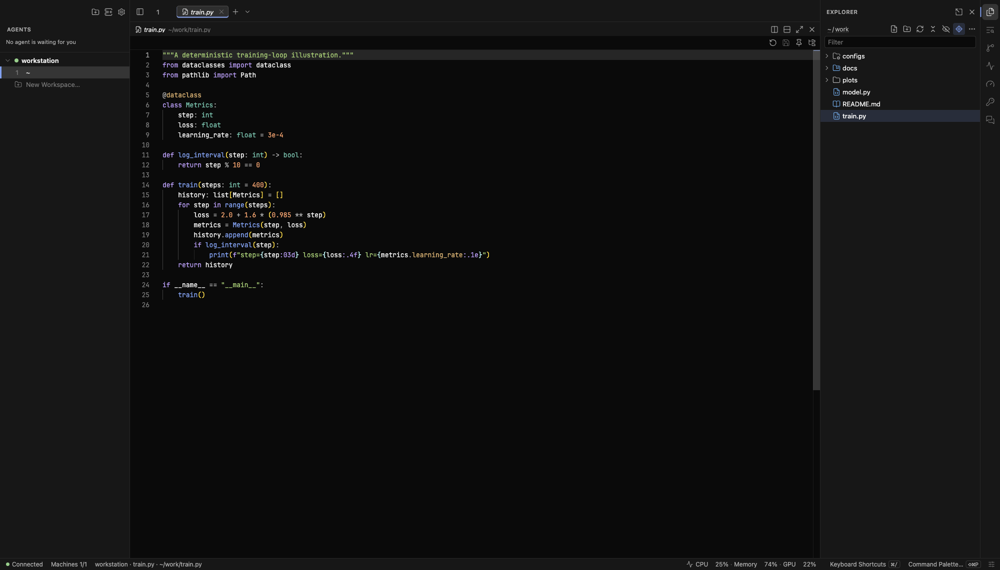</a>
      <br><b>Desktop app.</b> The same workspaces and features run in the Electron shell with an in-process hub.
    </td>
  </tr>
</table>

## Quick start

Install the CLI on Linux or macOS (`~/.local/bin/veldr`, verified against the release's `SHA256SUMS`):

```bash
curl -fsSL https://veldr.app/cli/install.sh | sh
veldr
```

Or build from source:

- an OpenSSH client with working access to the machines you want to use (this host needs none);
- to build: Bun 1.4.5 (the hub, its machine side and the build's tools), Node.js 22.12+ and pnpm (`corepack enable` picks the pinned version).

```bash
make deps && make build
cd dist/packages/veldr-$(scripts/platform.sh)
./veldr
```

Or extract the matching archive from `dist/release/` and run `./veldr`; to download a release by hand, see [Download from GitHub Releases](#download-from-github-releases). Add SSH machines with **Add Machine…** in the sidebar. A hub from GitHub Releases has each machine download its platform's build. One built here serves machines of its own platform only, unless you build the others too (`TARGETS="linux/amd64 linux/arm64 …" make build`, its own among them) and start it with `--agent-dir dist/release`.

Open <http://127.0.0.1:7780>. The status bar opens the command palette and the list of shortcuts. All flags are listed in [docs/reference.md](docs/reference.md).

## Download from GitHub Releases

Each release on [GitHub Releases](https://github.com/davidliyutong/veldr/releases) has the command line for Linux and macOS, the desktop app for macOS, Windows and Linux, and a `SHA256SUMS` file covering all of them. Pick the files for your system:

| System | Command line (hub and machine side) | Desktop app |
| --- | --- | --- |
| macOS, Apple Silicon | `veldr-darwin-arm64.tar.gz` | `veldr-<version>-mac-arm64.dmg` or `.zip` |
| macOS, Intel | `veldr-darwin-amd64.tar.gz` | `veldr-<version>-mac-x64.dmg` or `.zip` |
| Linux x86-64 | `veldr-linux-amd64.tar.gz` | `veldr-<version>-linux-amd64.deb`, `veldr-<version>-linux-x86_64.AppImage` |
| Linux ARM64 | `veldr-linux-arm64.tar.gz` | `veldr-<version>-linux-arm64.deb`, `veldr-<version>-linux-arm64.AppImage` |
| Linux with musl (Alpine) | `veldr-linux-amd64-musl.tar.gz`, `veldr-linux-arm64-musl.tar.gz` | – |
| Windows x64 | – (the hub runs inside the desktop app) | `veldr-<version>-win-x64.exe` |

To install the command line by hand, download the archive and `SHA256SUMS`, check the archive, and run the executable inside it:

```bash
name=veldr-linux-amd64        # your archive's name without .tar.gz
base=https://github.com/davidliyutong/veldr/releases/latest/download
curl -fL -O "$base/$name.tar.gz" -O "$base/SHA256SUMS"
sha256sum -c --ignore-missing SHA256SUMS    # macOS: shasum -a 256 -c --ignore-missing SHA256SUMS
tar -xzf "$name.tar.gz"
"./$name/veldr"
```

- For a particular release, replace `latest/download` with `download/v0.6.0` (its tag). With the GitHub CLI: `gh release download --repo davidliyutong/veldr -p "$name.tar.gz" -p SHA256SUMS`.
- To run it from anywhere, copy `$name/veldr` into a directory on your `PATH`, such as `~/.local/bin`; the install script in [Quick start](#quick-start) does exactly that.
- On macOS, an archive downloaded with a browser is quarantined and Gatekeeper refuses its executable: download it with `curl` as above, or run `xattr -d com.apple.quarantine "$name.tar.gz"` before extracting it.
- Musl builds need `libstdc++` and `libgcc` (Alpine: `apk add libstdc++ libgcc`).
- To update, install a newer release over the old one; the machines get the same version when the hub next connects to them.

For the desktop app, download its package for your system from the same release and follow [Desktop app](#desktop-app).

## Desktop app

The same UI in an Electron app with a hub of its own, which runs inside the app and listens on no port (instance `desktop`), for macOS, Windows and Linux. It shares its settings, keybindings, machines and variable vault with `veldr` run without `--instance` (in `~/.veldr/`), and the machines' terminals and chats with every hub of the default namespace. Download it from GitHub Releases:

| | macOS | Windows | Linux |
| --- | --- | --- | --- |
| Packages | `…-mac-arm64.dmg` (Apple Silicon), `…-mac-x64.dmg` (Intel), also as `.zip` | `…-win-x64.exe`, a setup for your user (no administrator) | `…-linux-amd64.deb`, `…-linux-arm64.deb`, `…-linux-x86_64.AppImage`, `…-linux-arm64.AppImage` |
| Signing | ad hoc, unless the release was built with a Developer ID (then notarized) | none | none |
| Local terminals | yes | no: the local machine needs Linux or macOS | yes |
| SSH machines | yes | yes, with key authentication | yes |
| VS Code | every machine | SSH machines | every machine |
| Program windows | of remote Linux machines | of remote Linux machines | of remote Linux machines |
| Notifications | yes, with a badge on the Dock icon | yes, with an overlay on the taskbar button | with a notification daemon (desktop environments run one) |

- **macOS:** drag the app from the DMG to Applications. If macOS says it cannot check the app for malicious software, Control-click the app and choose **Open** (on macOS 15 and later: **Open Anyway** under System Settings → Privacy & Security). For terminals to open Desktop, Documents, Downloads or external disks without asking, grant Full Disk Access under **Settings → Terminal → Permissions**; an app signed ad hoc needs it again after each update.
- **Windows:** run the setup; if SmartScreen says "Windows protected your PC", choose **More info** → **Run anyway**. The app needs Windows' OpenSSH Client and works on SSH machines only: accept each host key once with `ssh <target>` and use a key the ssh agent holds (`ssh-add`), since the app cannot ask for a password.
- **Linux:** `sudo apt install ./veldr-<version>-linux-amd64.deb` (Ubuntu 24.04 and later need the deb, which lets Chromium's sandbox run). The AppImage needs `chmod +x` and FUSE 2 (`libfuse2`, `libfuse2t64` on Ubuntu 24.04).

There are no automatic updates: install a newer release over the old one. Or build the app for the system you are on:

```bash
make desktop-app                 # the unpacked app in dist/desktop/
make desktop-dist                # this system's installers: DMG and zip, setup, or AppImage and deb
make desktop-install             # macOS: the .app, copied into /Applications
ARCH=x64 make desktop-dist       # another architecture; default is the host Node architecture
```

Drag folders onto the sidebar or the Dock icon to create a workspace for each on the local machine. The app's shortcuts are direct keys (`cmd+t`, `cmd+w`, `cmd+d` on macOS; `ctrl+t`, `ctrl+shift+w` on Windows and Linux; `cmd+shift+t` / `ctrl+shift+t` reopens what was closed, as in browsers); every other key, `ctrl+c` included, reaches the terminal. The full list is in [docs/reference.md](docs/reference.md#keyboard-shortcuts); change keys under **Settings → Keyboard Shortcuts**.

Quitting the app stops its hub; the machines' terminals keep running. See [desktop deployment](docs/deployment.md#desktop-app) for paths, versioning and isolated development.

## Remote access

veldr has no login of its own: keep it on `127.0.0.1` and put an authenticating reverse proxy with HTTPS in front (Tailscale, Caddy, nginx), then pass its origin with `--allowed-origin`. Optional guardrails: a proxy secret header, a read-only mode and an audit log. See [docs/deployment.md](docs/deployment.md) and [SECURITY.md](SECURITY.md).

## Air-gapped networks

Machines need no internet access. A machine that has it downloads its platform's veldr from the GitHub release, checked against the release's `SHA256SUMS`; to one that has not, the hub uploads it over ssh, and a hub host that cannot reach the release fetches `SHA256SUMS` through the machine's ssh connection, with its own TLS end to end. Claude Code's chats need Anthropic's Agent SDK, which machines get from the npm registry the same way. code-server and extensions are resolved on the host running veldr and pushed to the machines (the AI usage plugin asks the AI providers' hosts from the machines whose CLIs are signed in to them; it fails quietly without internet). If the host running veldr is offline too, run `veldr fetch-assets DIR` on a connected machine, carry `DIR` over and start with `--offline --seed-dir DIR`; for machines of another platform than that host's, add `--agent-dir` with a directory holding the release's `SHA256SUMS` and their archives. Downloads are verified against pinned SHA-256 digests. Details in [docs/deployment.md](docs/deployment.md#air-gapped-networks).

## Documentation

- [docs/reference.md](docs/reference.md) – flags, shortcuts, environment, files
- [docs/deployment.md](docs/deployment.md) – reverse proxies, air-gapped installs, remote resources, services
- [docs/architecture.md](docs/architecture.md) – components and protocols
- [docs/features/](docs/features/README.md) – one design document per feature, with the alternatives considered
- [SECURITY.md](SECURITY.md) – threat model and reporting

## Development

```bash
make dev-hub       # hub on :7790 with --instance dev (terminal core session veldr-dev-<host id>)
make dev-web       # UI with hot reload on :5173
make check test    # before sending a PR
```

See [CONTRIBUTING.md](CONTRIBUTING.md); coding agents start with [AGENTS.md](AGENTS.md).

## Contributing

Issues and pull requests are welcome, in English or Chinese. Please read [CONTRIBUTING.md](CONTRIBUTING.md) and the [Code of Conduct](CODE_OF_CONDUCT.md) first.

## License

[MIT](LICENSE). Third-party licenses: [THIRD_PARTY_NOTICES.md](THIRD_PARTY_NOTICES.md) (the hub's Bun runtime and npm packages) and `/licenses.md` served by the hub (the web UI bundle, with Ghostty's terminal library (MIT), KaTeX and the JetBrains Mono font). The hub embeds [herdr-core](https://github.com/herdrdev/herdr-core) (Apache-2.0) for machines; release archives carry its license and notices in `licenses/herdr-core/`. The agents carry herdr's agent detection rules (Apache-2.0, [licenses/herdr-detect/](licenses/herdr-detect/)), and the hub the video encoder for Linux machines (FFmpeg, LGPL-2.1, with libvpx, libva and libdrm; [licenses/encoder/](licenses/encoder/)). code-server and Git Graph retain their own licenses and are downloaded at runtime. Git Graph restricts derivative distribution and does not clearly grant general redistribution of the original; it is excluded from public release packages.
