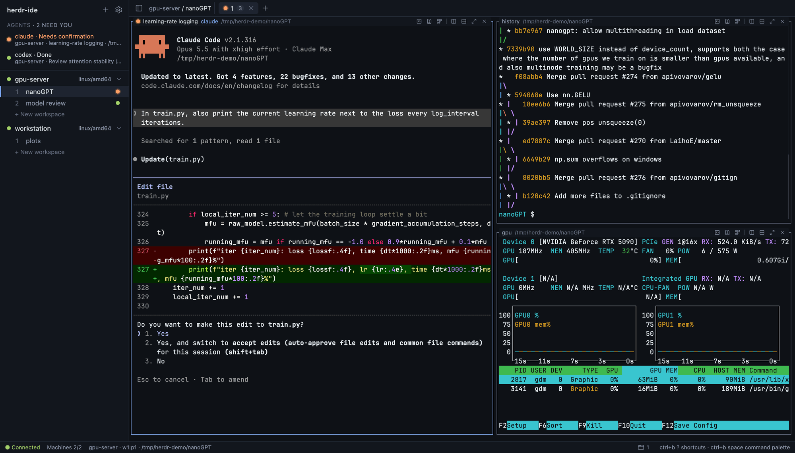
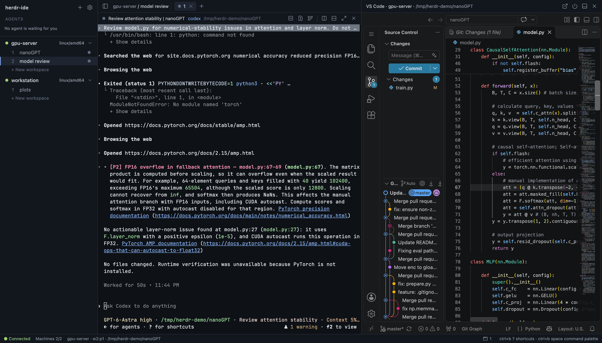
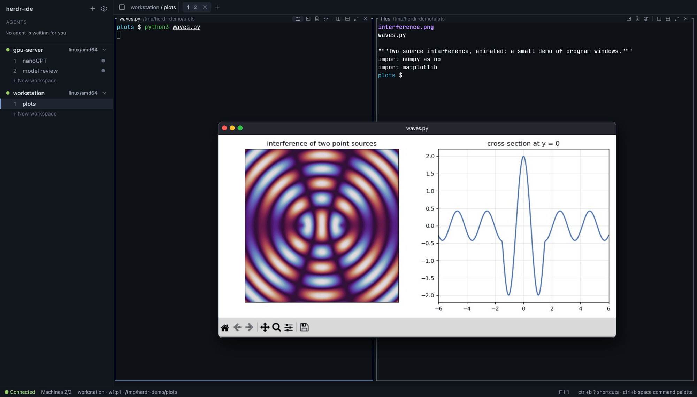
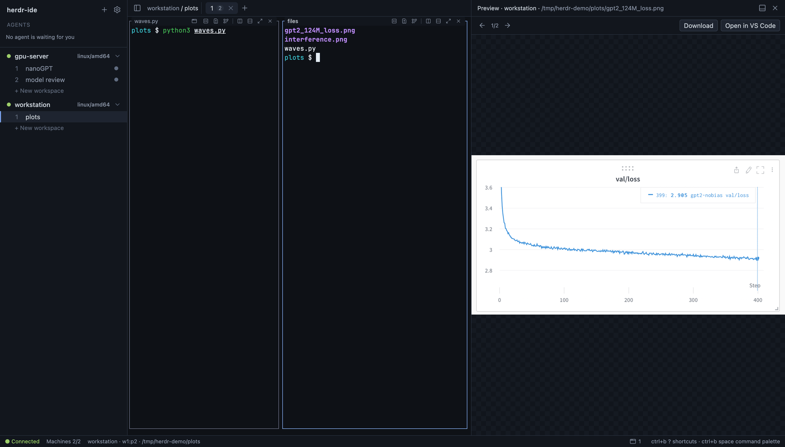

# herdr-ide

English | [简体中文](README.zh-CN.md)

A terminal-first, multi-machine, agent-native web IDE for
[herdr](https://herdr.dev): your herdr workspaces on every machine in one
browser tab, with VS Code (code-server) one keystroke away.



## Features

- **Speaks herdr's protocol.** Workspaces, tabs, split layouts and agent
  states come from herdr's socket API; panes are drawn from the cell grid
  herdr renders through its endpoint protocol, and herdr encodes every key
  for the program in the pane (kitty keyboard protocol included). Mouse,
  scrollback (selections stay in their pane, scroll past the edge and copy
  whole), IME, OSC 52 copy (a selection in Claude Code goes straight to the
  clipboard), resizable splits, and programs see the UI
  theme's colors. One browser tab uses the session at a time; another tab
  can take it over. Drag a pane by its header to swap or move it, click its title to
  rename it; drag tabs and workspaces to reorder them; right-click a pane
  header, tab or workspace for its commands, or a pane's text to copy,
  paste or open a path. Keyboard shortcuts follow your
  herdr configuration (prefix `ctrl+b`).
- **herdr included.** Release archives carry herdr 0.9.5 for Linux/macOS on
  amd64/arm64, used when this host has no herdr installed. It behaves like an
  installed herdr: same configuration, sessions and machines. Right-click a
  machine to **Restart herdr…** (also to start it after the machine
  rebooted) or **Stop herdr…**, without a terminal; **Update herdr…** on the
  local machine updates herdr through herdr's own updater, on an SSH machine
  it runs herdr's own `herdr --remote` update there, and **Install herdr**
  the same flow where herdr was removed or moved. Disabling an SSH machine
  can stop its herdr too.
- **Multi-machine.** Uses the SSH machines saved in herdr; right-click the
  sidebar to add one (herdr's own `herdr machine add`, in a terminal), or a
  machine to rename it or remove it from herdr, or to disable or enable it
  here; the sidebar's reload button picks up changes made with herdr's own
  commands. One ssh connection per machine runs a small static agent
  (linux/macOS × amd64/arm64, uploaded automatically) that multiplexes
  everything; nothing listens on the machines.
- **Agent-native.** An inbox of agents that are blocked or done across all
  machines, browser notifications and sounds when an agent needs input or
  finishes, starting agents from the command palette,
  sending code from VS Code to the focused agent, pasting images into agent
  prompts.
- **VS Code on demand.** code-server is installed per machine from the core
  host (no internet needed on machines), downloaded by the machines
  themselves, or taken from an existing install, with Git Graph and a bridge
  extension: open a pane's folder, its diff or Git Graph with one key or
  from the buttons in the pane's header; jump from a `path:line` in the terminal
  to the editor. Each workspace has its own panel, so several VS Code
  windows stay open and switching workspace switches between them. The
  panel sits beside or below the terminals. Idle instances are stopped.
- **Program windows.** Windows that programs on remote Linux machines open
  (matplotlib, the MuJoCo viewer, Qt tools) appear in browser windows, one
  per program window, with mouse and keyboard. Panes get a virtual display
  automatically; Xvfb is fetched without root when a machine lacks it, and
  VirtualGL renders OpenGL on the GPU where it is installed. Windows that
  keep changing are sent as video (H.264 on NVIDIA, Intel and AMD GPUs, VP8
  otherwise) to browsers that decode it, still ones as exact pictures.
- **Quick Look.** ⌘/Ctrl-click or right-click a path in a terminal, also one
  wrapped over several lines, to preview images, GIFs, videos (with
  seeking), audio, PDFs, text or directories.
- **Formulas.** Rest the pointer on a LaTeX formula an agent wrote in a
  pane (`$…$`, `$$…$$`, `\(…\)`, `\[…\]`, also with the backslashes its
  markdown dropped) to see it typeset, and copy its source.
- **Find.** ⌘F (Ctrl+Shift+F on other systems) finds text in a pane's
  output, scrollback included: every match is highlighted, Enter and
  Shift+Enter step to older and newer ones, scrolling them into view.
- **Files to agents.** Paste or drop files into a pane to paste their paths;
  files that are not on the pane's machine are uploaded to it first, dropped
  ones into the pane's directory (an existing file there is never replaced).
  The uploads panel in the status bar shows each upload's progress and
  speed, cancels uploads and lists the recent ones.
- **Files from machines.** Right-click in a pane to download the path under
  the pointer, or choose files and folders of the pane's directory to
  download together; folders arrive as zip archives, streamed from the
  machine. VS Code's explorer has the same download.
- **Several browsers at once.** The active browser controls a pane; others
  watch at the same size and take over by typing.
- **Settings.** Language (English, Chinese), light/dark theme followed by
  VS Code, interface and terminal font sizes, terminal font weight, panel
  position and the code-server installation method, in one dialog
  (`ctrl+b ,`). Terminals use the included JetBrains Mono font in every
  browser.

## Screenshots

**VS Code beside the terminals.** An agent's `path:line` opens in VS Code
on the machine where the pane runs; the pane header opens its folder, its
diff or Git Graph.



**Program windows.** A matplotlib window on a remote Linux machine opens in
a browser window of its own, with mouse and keyboard.



**Quick Look.** Right-click or ⌘/Ctrl-click a path in a terminal to preview
it; the arrows step through the other files of the folder.



## Quick start

Requirements:

- [herdr](https://herdr.dev) 0.9.5 or newer running on every machine you
  want to use (this host can use the herdr included in the release), with
  remote machines saved through `herdr machine add`;
- an OpenSSH client with working access to those machines;
- to build: Go (version in `go.mod`), Node.js 22.12+ and pnpm (`corepack enable`
  picks the pinned version).

```bash
make deps && make build
cd dist/packages/herdr-ide-$(go env GOOS)-$(go env GOARCH)
./herdr-ide
```

Or extract the matching archive from `dist/release/` (or GitHub Releases)
and run `./herdr-ide`; keep the directory together. Without an installed
herdr, `./herdr-ide herdr [args]` runs the included one, for example
`./herdr-ide herdr` to open its TUI (which starts the local herdr server) or
`./herdr-ide herdr machine add user@host --label gpu`.

Open <http://127.0.0.1:7780>. Press `ctrl+b space` for the command palette and
`ctrl+b ?` for shortcuts. All flags are listed in
[docs/reference.md](docs/reference.md).

## macOS desktop app

On macOS, download the DMG for your Mac from GitHub Releases
(`…-mac-arm64.dmg` for Apple Silicon, `…-mac-x64.dmg` for Intel) and drag
the app to Applications. It is not notarized, so allow the first launch under
System Settings → Privacy & Security. Or build the Electron app, with the
same embedded core, UI, agents and VS Code bridge, yourself:

```bash
make desktop-app                 # .app in dist/desktop/mac[-arm64]/
make desktop-dmg                 # .app plus a drag-to-Applications .dmg
make desktop-install             # .app, copied into /Applications
ARCH=x64 make desktop-dmg        # Intel; default is the host Node architecture
```

The desktop and browser share a terminal-pane icon, with a multi-resolution
macOS version for Finder and the Dock.

Drag folders from Finder onto the sidebar or the app's Dock icon to create a
workspace for each on the local machine. Files and folders dropped on a pane
of the local machine are pasted as their own paths, without uploading.

In the app, `cmd+t` opens a tab, `cmd+w` closes it (asking first when a
program runs in it), `cmd+n` creates a workspace, `cmd+,` opens the
settings and `cmd+j` shows or hides the VS Code panel; while VS Code has focus, all but `cmd+j` stay VS Code's.
Change or remove them under **Settings → Shortcuts**. Prefix bindings keep
working, and browsers keep their own `cmd+t` / `cmd+w`.

The app starts its own core at `http://127.0.0.1:7781` with instance
`desktop`; quitting or closing the main window stops that core. The app
includes herdr, used when none is installed; OpenSSH must already be
installed. Released and local builds use ad-hoc signing,
without Apple notarization or automatic updates. See
[desktop deployment](docs/deployment.md#macos-desktop-app) for paths,
versioning and isolated development. Only macOS packaging is implemented.

## Remote access

herdr-ide has no login of its own: keep it on `127.0.0.1` and put an
authenticating reverse proxy with HTTPS in front (Tailscale, Caddy, nginx), then
pass its origin with `--allowed-origin`. Optional guardrails: a proxy secret
header, a read-only mode and an audit log. See
[docs/deployment.md](docs/deployment.md) and [SECURITY.md](SECURITY.md).

## Air-gapped networks

Machines never download anything. If the host running herdr-ide is offline
too, run `herdr-ide fetch-assets DIR` on a connected machine, carry `DIR` over
and start with `--offline --seed-dir DIR`. Downloads are verified against
pinned SHA-256 digests. Details in
[docs/deployment.md](docs/deployment.md#air-gapped-networks).

## Documentation

- [docs/reference.md](docs/reference.md) – flags, shortcuts, environment, files
- [docs/deployment.md](docs/deployment.md) – reverse proxies, air-gapped installs, remote resources, services
- [docs/architecture.md](docs/architecture.md) – components and protocols
- [docs/features/](docs/features/README.md) – one design document per feature, with the alternatives considered
- [SECURITY.md](SECURITY.md) – threat model and reporting

## Development

```bash
herdr --session herdr-ide-dev server &   # isolated herdr session
make dev-core                            # core on :7790 with --instance dev
make dev-web                             # UI with hot reload on :5173
make check test                          # before sending a PR
```

See [CONTRIBUTING.md](CONTRIBUTING.md); coding agents start with
[AGENTS.md](AGENTS.md).

## Contributing

Issues and pull requests are welcome, in English or Chinese. Please read
[CONTRIBUTING.md](CONTRIBUTING.md) and the
[Code of Conduct](CODE_OF_CONDUCT.md) first.

## License

[MIT](LICENSE). Third-party licenses: [THIRD_PARTY_NOTICES.md](THIRD_PARTY_NOTICES.md)
(Go modules) and `/licenses.md` served by the binary (web UI bundle).
The bundled herdr is Apache-2.0; its license and dependency notices are in
[licenses/herdr/](licenses/herdr/). code-server and Git Graph retain their
own licenses and are downloaded at runtime. Git Graph restricts derivative
distribution and does not clearly grant general redistribution of the original;
it is excluded from public release packages.
