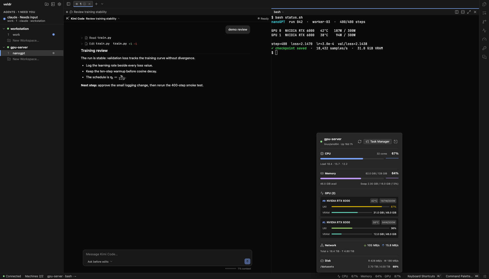

# herdr-ide

English | [简体中文](README.zh-CN.md)

A terminal-first, multi-machine, agent-native web IDE built on the
[herdr-core](https://github.com/herdrdev/herdr-core) terminal core: the
workspaces and terminals of every machine in one browser tab, with VS Code
(code-server) one click away.



## Features

- **Terminals in the browser.** Each machine's terminal core (herdr-core)
  runs the programs; the browser emulates every terminal itself with
  Ghostty's terminal library, compiled to WebAssembly, and draws it with
  WebGL (Canvas 2D without it). Keys are encoded for the program in the
  pane (kitty keyboard protocol included). Mouse, scrollback (selections
  scroll past the edge and copy whole), IME, OSC 52 copy (a selection in
  Claude Code goes straight to the clipboard), resizable splits, and
  programs see the UI theme's colors. Workspaces, tabs and splits are a
  layout document kept on each machine, the same in every browser and the
  desktop app. Drag a pane by its header to swap or move it; double-click
  a tab, workspace, pane title or machine to rename it in place (a
  workspace's menu edits its name and folder; without a folder, new
  terminals start in the focused pane's); drag a pane onto another
  workspace in the sidebar, or use its **Move to Workspace** menu, to move
  it there; drag a tab onto a pane of another tab to split them side by
  side, as in Edge (terminals, VS Code and plugin panes alike); drag tabs,
  workspaces and machines to reorder them; drag the sidebar's edge or a split's
  handle to resize them (a double click restores the default or equal
  sizes); every tab has a × and a middle
  click closes it; right-click a pane header, tab, workspace or machine
  for its commands, or a pane's text to copy, paste or open a path. Everything is
  in reach of the mouse; the few default keys take nothing from the
  programs in the terminals (`ctrl+b` reaches tmux), and every key can be
  bound in the settings.
- **Terminal core included.** The binary carries herdr-core for Linux/macOS
  on amd64/arm64 and installs it on a machine the first time its terminals
  are shown; machines need nothing installed and no internet. Programs keep running
  when the browser closes or the core stops. A machine's menu has
  **Troubleshooting** ▸ **Restart Terminal Service…** (its programs keep
  running), **Start Terminal Service** and **Stop Terminal Service…**.
- **Multi-machine.** Keeps its own list of SSH machines (the machines saved
  in herdr are imported the first time); right-click the sidebar to add one
  (a host of your `~/.ssh/config`, picked from a list, or any ssh target,
  and a label; a password or host key is asked for in a terminal), or a machine to rename, remove, disable or enable it or open
  its **Machine Settings…**. One ssh
  connection per machine runs a small static agent
  (linux/macOS × amd64/arm64, uploaded automatically) that multiplexes
  everything; nothing listens on the machines.
- **Agent-native.** An inbox of agents that are blocked or done across all
  machines, browser notifications and sounds when an agent needs input or
  finishes, starting agents from the command palette,
  sending code from VS Code to an agent of its workspace, pasting images into agent
  prompts. Each machine's agent tells which coding agent runs in a terminal
  and whether it works, waits or finished a turn, with herdr's rules for
  Claude Code, Codex, Gemini, OpenCode and more.
- **VS Code on demand.** code-server is installed per machine from the core
  host (no internet needed on machines), downloaded by the machines
  themselves, or taken from an existing install, with Git Graph and a bridge
  extension. VS Code is a pane like a terminal: **Open in VS Code** (the
  pane header's button, the pane's menu, the command palette, `cmd+j` in
  the desktop app) opens a folder as a new tab, a pane's diff and Git Graph
  open in VS Code beside it, and a `path:line` in the terminal opens in the
  workspace's VS Code pane, else in one beside the terminal. VS Code panes
  split, move between tabs, maximize and come back after a restart; moving
  one or switching tabs does not reload it. Idle instances are stopped.
- **Program windows.** Windows that programs on remote Linux machines open
  (matplotlib, the MuJoCo viewer, Qt tools) appear in browser windows, one
  per program window, with mouse and keyboard. Terminals get a virtual
  display automatically (a shell opened before can be given it from
  its menu); Xvfb is fetched without root when a machine lacks it, and
  VirtualGL renders OpenGL on the GPU where it is installed. Windows that
  keep changing are sent as video (H.264 on NVIDIA, Intel and AMD GPUs, VP8
  otherwise) to browsers that decode it, still ones as exact pictures.
- **Quick Look.** ⌘/Ctrl-click or right-click a path in a terminal, also one
  wrapped over several lines, to preview images, GIFs, videos (with
  seeking), audio, PDFs, text or directories in a preview pane.
- **Formulas.** Rest the pointer on a LaTeX formula an agent wrote in a
  pane (`$…$`, `$$…$$`, `\(…\)`, `\[…\]`, also with the backslashes its
  markdown dropped) to see it typeset, and copy its source.
- **Find.** ⌘F (Ctrl+Shift+F on other systems) finds text in a pane's
  output, scrollback included: every match on the screen is highlighted,
  Enter and Shift+Enter step to older and newer ones, scrolling them into
  view.
- **Files to agents.** Paste or drop files into a pane to paste their paths;
  files that are not on the pane's machine are uploaded to it first, dropped
  ones into the pane's directory (an existing file there is never replaced).
  The uploads panel in the status bar shows each upload's progress and
  speed, cancels uploads and lists the recent ones.
- **Files from machines.** Right-click in a pane to download the path under
  the pointer, or choose files and folders of the pane's directory to
  download together; folders arrive as zip archives, streamed from the
  machine. VS Code's explorer has the same download. The downloads panel in
  the status bar shows each download's progress, speed and result, and
  cancels or repeats it.
- **Several browsers at once.** Every browser and the desktop app show the
  same terminals and type into them; the one used last sets a terminal's
  size.
- **Plugins and the right sidebar.** Features that come as plugins add
  panels to a sidebar on the right (⌘⌥B in the desktop app on macOS),
  panes of their own, commands and status bar items; each can be turned
  off in Settings › Plugins. Uploads and downloads, program windows and
  VS Code are plugins too (VS Code off, code-server is never fetched or
  started).
- **File explorer.** A tree of the machine's files in the right sidebar
  (⌘⇧E in the desktop app on macOS) that follows the focused terminal's
  directory, as VS Code's explorer works: filter, hidden files, keys,
  new files and folders, rename, cut, copy and paste, drag to move, drop
  files from your computer to upload them, Move to Trash, copy paths,
  download, open in a terminal or VS Code. A click shows a file in a
  preview editor that the next click replaces, a double click keeps it
  open, as in VS Code (text in Monaco, images, video and PDFs as Quick Look
  shows them); saves never overwrite a change made on the machine since it
  was opened. Changed files are colored by their Git status and the
  editor's gutter marks changed lines.
- **Git.** VS Code's Source Control and Git Graph without VS Code, for the
  focused pane's repository on any machine: a panel (Ctrl+Shift+G in the
  desktop app) with the branch, ahead/behind, fetch, pull and push, staged
  and unstaged changes as a list or tree, commits (⌘/Ctrl+Enter, amend),
  stashes and, docked at its bottom, the whole history with its graph
  (scrolls through every commit, a click shows its files); a graph pane with lanes, branch and tag badges, search, a
  branch filter, a commit's files and context menus (checkout, branches,
  tags, merge, rebase, cherry-pick, revert, reset); diffs in Monaco, side by
  side or inline, where selected ranges are staged, unstaged or discarded
  and the working tree's side is editable. Changed files are colored in the
  file explorer ([31](docs/features/31-git.md)).
- **Variable vault.** API keys and other environment variables, encrypted
  on the core's computer (the key in the system keychain, or from a
  passphrase), for coding agents on every machine: Claude Code, Codex and
  other MCP clients read them through the vault's MCP server, which the
  panel shows how to add per machine. Each variable names the machines that
  may read it; others ask on every page (allow once, always, deny), and
  `run_with_env` runs a command with the variables set without showing
  their values to the model ([30](docs/features/30-variable-vault.md)).
- **AI usage.** A panel of the right sidebar and a status bar item show
  what the AI subscriptions signed in on your machines have left — Claude,
  Codex, Grok, Antigravity, Kimi Code and DeepSeek: each window's use, its
  reset countdown and whether its pace runs it out first, credits and
  balances, incidents of the providers' status pages — one card per
  account even when several machines share it, with notifications at the
  thresholds you choose. A Cost tab adds up what the CLIs' local logs
  would cost at API prices, by day, model, project and machine. Credentials
  are read where they are, read only, and never leave the machine.
- **Settings.** Language (English, Chinese), light/dark theme followed by
  VS Code, color themes (the accent: blue, VS Code blue, teal, violet,
  rose, amber, graphite), interface size, the desktop app's zoom, the terminals' font (picked from the monospace
  fonts installed, with a preview), line height, cursor, scrollback, bell,
  color schemes (Dracula, Nord, Solarized, One, Gruvbox, Tomorrow…) with
  your own colors on top, notification sounds, system notifications and
  the Dock/taskbar badge each on or off, silent agents, how each machine
  gets VS Code, program windows per machine and every keyboard shortcut,
  in one dialog laid out as VS Code's (the sidebar's gear, `cmd+,` or
  `ctrl+,` in the desktop app; a machine's own settings from its menu) with
  search. Settings and keys are kept on the core's
  host in two JSON files you can also edit by hand, and are the same in
  every browser and the desktop app. Terminals use
  the included JetBrains Mono font unless you choose another.

## Screenshots

**VS Code beside the terminals.** An agent's `path:line` opens in VS Code
on the machine where the pane runs; the pane header opens its folder, its
diff or Git Graph.


**Program windows.** A matplotlib window on a remote Linux machine opens in
a browser window of its own, with mouse and keyboard.


**Quick Look.** Right-click or ⌘/Ctrl-click a path in a terminal to preview
it; the arrows step through the other files of the folder.


## Quick start

Requirements:

- an OpenSSH client with working access to the machines you want to use
  (this host needs none);
- to build: Go (version in `go.mod`), Node.js 22.12+ and pnpm (`corepack enable`
  picks the pinned version).

```bash
make deps && make build
cd dist/packages/herdr-ide-$(go env GOOS)-$(go env GOARCH)
./herdr-ide
```

Or extract the matching archive from `dist/release/` (or GitHub Releases)
and run `./herdr-ide`. Add SSH machines with **Add machine…** in the
sidebar. Coming from a version that drew its panes from herdr: settings,
keys and machines move over on the first start, terminals stay in herdr
([migration](docs/deployment.md#migrating-from-versions-that-used-herdr)).

Open <http://127.0.0.1:7780>. The status bar opens the command palette and
the list of shortcuts (`cmd+k` and `cmd+/` in a browser on macOS,
`ctrl+shift+/` for the shortcuts elsewhere). All flags are listed in
[docs/reference.md](docs/reference.md).

## Desktop app

The same UI in an Electron app with a core of its own
(`http://127.0.0.1:7781`, instance `desktop`), for macOS, Windows and Linux.
Download it from GitHub Releases:

| | macOS | Windows | Linux |
| --- | --- | --- | --- |
| Packages | `…-mac-arm64.dmg` (Apple Silicon), `…-mac-x64.dmg` (Intel), also as `.zip` | `…-win-x64.exe`, a setup for your user (no administrator) | `…-linux-amd64.deb`, `…-linux-arm64.deb`, `…-linux-x86_64.AppImage`, `…-linux-arm64.AppImage` |
| Signing | ad hoc, unless the release was built with a Developer ID (then notarized) | none | none |
| Local terminals | yes | no: the local machine needs Linux or macOS | yes |
| SSH machines | yes | yes, with key authentication | yes |
| VS Code | every machine | SSH machines | every machine |
| Program windows | of remote Linux machines | of remote Linux machines | of remote Linux machines |
| Notifications | yes, with a badge on the Dock icon | yes, with an overlay on the taskbar button | with a notification daemon (desktop environments run one) |

- **macOS:** drag the app from the DMG to Applications. If macOS says it
  cannot check the app for malicious software, Control-click the app and
  choose **Open** (on macOS 15 and later: **Open Anyway** under System
  Settings → Privacy & Security). The app stays in the Dock when its
  window closes, until you quit it. For terminals and the file browser to
  reach other apps' data (Mail, Messages, Safari) and open Desktop,
  Documents, Downloads or external disks without asking, give them Full
  Disk Access under **Settings → Terminal → Permissions**: it opens System
  Settings, where you turn on herdr-ide and add herdr-core, which runs the
  terminals, and tells you what to restart. An app signed ad hoc needs it
  again after each rebuild or update.
- **Windows:** run the setup; if SmartScreen says "Windows protected your
  PC", choose **More info** → **Run anyway**. The app needs Windows'
  OpenSSH Client (installed by default on Windows 10 1809 and later).
  It works on SSH machines: accept each machine's host key once with
  `ssh <target>` in a terminal, and use a key the ssh agent holds
  (`ssh-add`), since the app cannot ask for a password. WSL is not built in;
  a WSL distribution running an ssh server can be added as an SSH machine.
- **Linux:** `sudo apt install ./herdr-ide-<version>-linux-amd64.deb`
  (Ubuntu 24.04 and later need the deb, which lets Chromium's sandbox run).
  The AppImage needs `chmod +x` and FUSE 2 (`libfuse2`, `libfuse2t64` on
  Ubuntu 24.04).

There are no automatic updates: install a newer release over the old one.
Or build the app, with the same embedded core, UI, agents and VS Code
bridge, for the system you are on:

```bash
make desktop-app                 # the unpacked app in dist/desktop/
make desktop-dist                # this system's installers: DMG and zip, setup, or AppImage and deb
make desktop-install             # macOS: the .app, copied into /Applications
ARCH=x64 make desktop-dist       # another architecture; default is the host Node architecture
```

Drag folders from the file manager onto the sidebar, onto the Dock icon on
macOS, or open them with the app on Linux (**Open With**), to create a
workspace for each on the local machine. Files and folders dropped on a
pane of the local machine are pasted as their own paths, without uploading.

On macOS `cmd+t` opens a tab, `cmd+1`…`cmd+9` select one (`cmd+9` the
last), `cmd+shift+w` closes it, `cmd+w` closes the pane (or a workspace with no tab left), `cmd+d` /
`cmd+shift+d` split it, `cmd+alt+arrows` move between panes, `cmd+[` /
`cmd+]` go back and forward through the panes focused, `cmd+w` closes at once and `cmd+z` undoes it within 5 s
(the same terminal, its program still running),
`cmd+shift+enter` maximizes one, `cmd+n` creates a workspace, `cmd+,` opens
the settings, `cmd+shift+p` the command palette, `cmd+j` opens the focused
pane's folder in VS Code and `cmd++`, `cmd+-` and `cmd+0` zoom the window,
terminals included. On Windows and Linux `ctrl+shift+t` opens a tab,
`ctrl+tab` and `alt+1`…`alt+9` switch tabs, `ctrl+shift+w` closes one,
`ctrl+shift+n` creates a workspace, `ctrl+,` opens the settings,
`ctrl+shift+p` the command palette, `ctrl+shift+j` opens VS Code and
`ctrl++`, `ctrl+-` and `ctrl+0` zoom;
every other key, `ctrl+c` and `ctrl+q` included, reaches the terminal.
While VS Code has focus, its own keys come first (`cmd+j` toggles its
bottom panel), except `cmd+w` on macOS, which closes the VS Code pane. The menu
bar shows the keys in effect, in the UI's language; the title bar follows
the UI's theme.
Change or remove the keys under **Settings → Keyboard Shortcuts**, where
chords such as `ctrl+b c` can be bound too; browsers keep their own
`cmd+t` / `cmd+w`.

Quitting the app stops its core; the machines' terminals keep running.
OpenSSH must already be installed. See
[desktop deployment](docs/deployment.md#desktop-app) for paths, versioning
and isolated development.

## Remote access

herdr-ide has no login of its own: keep it on `127.0.0.1` and put an
authenticating reverse proxy with HTTPS in front (Tailscale, Caddy, nginx), then
pass its origin with `--allowed-origin`. Optional guardrails: a proxy secret
header, a read-only mode and an audit log. See
[docs/deployment.md](docs/deployment.md) and [SECURITY.md](SECURITY.md).

## Air-gapped networks

Machines never download anything (the AI usage plugin asks the AI
providers' hosts from the machines whose CLIs are signed in to them; it
fails quietly without internet). If the host running herdr-ide is offline
too, run `herdr-ide fetch-assets DIR` on a connected machine, carry `DIR` over
and start with `--offline --seed-dir DIR`. Downloads are verified against
pinned SHA-256 digests. Details in
[docs/deployment.md](docs/deployment.md#air-gapped-networks).

## Documentation

- [docs/reference.md](docs/reference.md) – flags, shortcuts, environment, files
- [docs/deployment.md](docs/deployment.md) – reverse proxies, air-gapped installs, remote resources, services
- [docs/architecture.md](docs/architecture.md) – components and protocols
- [docs/features/](docs/features/README.md) – one design document per feature, with the alternatives considered
- [SECURITY.md](SECURITY.md) – threat model and reporting

## Development

```bash
make dev-core      # core on :7790 with --instance dev (terminal core session herdr-ide-dev)
make dev-web       # UI with hot reload on :5173
make check test    # before sending a PR
```

See [CONTRIBUTING.md](CONTRIBUTING.md); coding agents start with
[AGENTS.md](AGENTS.md).

## Contributing

Issues and pull requests are welcome, in English or Chinese. Please read
[CONTRIBUTING.md](CONTRIBUTING.md) and the
[Code of Conduct](CODE_OF_CONDUCT.md) first.

## License

[MIT](LICENSE). Third-party licenses: [THIRD_PARTY_NOTICES.md](THIRD_PARTY_NOTICES.md)
(Go modules) and `/licenses.md` served by the binary (the web UI bundle,
with Ghostty's terminal library (MIT), KaTeX and the JetBrains Mono font).
The core embeds
[herdr-core](https://github.com/herdrdev/herdr-core) (Apache-2.0) for
machines; release archives carry its license and notices in
`licenses/herdr-core/`. The agents carry herdr's agent detection rules
(Apache-2.0, [licenses/herdr-detect/](licenses/herdr-detect/)), and the
core the video encoder for Linux machines (FFmpeg, LGPL-2.1, with libvpx,
libva and libdrm; [licenses/encoder/](licenses/encoder/)).
code-server and Git Graph retain their own licenses and are downloaded at
runtime. Git Graph restricts derivative distribution and does not clearly
grant general redistribution of the original; it is excluded from public
release packages.
