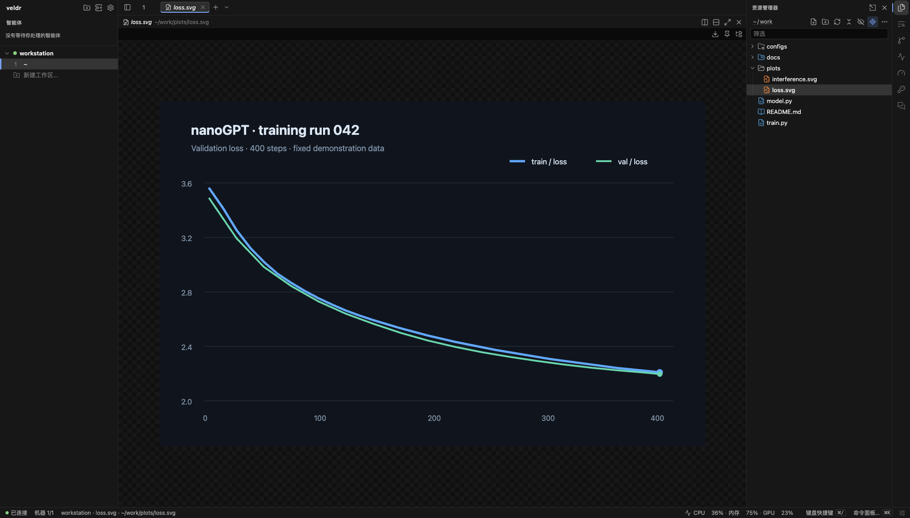

# herdr-ide

[English](README.md) | 简体中文

基于 [herdr-core](https://github.com/herdrdev/herdr-core) 终端核心的 Web IDE，以终端为中心，支持多台机器，围绕 agent 工作流设计：在一个浏览器标签页里使用所有机器上的 workspace 和终端，VS Code（code-server）点一下就能打开。

> 英文版 README 为主版本，本文与其保持相同的章节结构。
> 参数、快捷键等参考资料统一维护在英文文档 [docs/reference.md](docs/reference.md) 中。


## 功能

- **浏览器里的终端**：编译成 WebAssembly 的 Ghostty 终端库模拟每个终端，并用 WebGL 绘制。
  按键按窗格里程序的模式编码（包括 kitty 键盘协议），支持鼠标、中文输入法、滚动回看和 OSC 52 复制。
- **工作区、标签页和分屏**：保存在每台机器上的布局文档，所有浏览器和桌面应用看到的都一样。
  用鼠标即可拖动、重命名、固定、分屏和排序；右键任何东西都能打开它的命令菜单。
  固定的标签页排在最前，`cmd+w` 也不会关闭它。
- **按键留给程序**：默认快捷键很少，几乎不占用终端里程序要用的按键；`ctrl+b` 把键盘焦点从窗格移到应用界面，再按一次移回。
  所有快捷键都可以重新绑定或取消，包括组合键。
- **自带终端核心**：第一次显示某台机器的终端时自动把 herdr-core 装到那台机器上；机器上不需要预先安装任何东西，也不需要外网。
  关闭浏览器或停止 core 后，程序继续运行。
- **工作区自动恢复**：机器重启后，标签页恢复为各自文件夹里的 shell。
  Claude Code 和 Codex 经机器确认后回到各自原来的会话（`claude --resume <id>`、`codex resume <id>`），否则接着该文件夹里最近的一次对话继续（[33](docs/features/33-workspace-restore.md)）。
- **多机器**：可以添加 `~/.ssh/config` 里的任意主机或任意 ssh 目标。
  每台机器只开一条 ssh 连接，在上面运行一个静态 agent，所有通信都在这条连接里多路复用；机器上不监听任何端口。
  共用同一个主目录（NFS）的集群节点仍是各自独立的机器，各有自己的 socket、终端核心和文件（[40](docs/features/40-shared-homes.md)）。
- **为 agent 设计**：汇总所有机器上 blocked 和 done 的 agent，并发通知、播放提示音。
  每台机器都能识别 Claude Code、Codex、Gemini、OpenCode 等，以及它们是在工作、等待还是已完成。
  还能找出 Claude Code 和 Codex 正在使用的会话（[35](docs/features/35-agent-native-view.md)）。
- **智能体对话**：标签页可以是与 Claude Code、Codex、Kimi Code 或 Grok 的对话，智能体在任意机器上不经终端运行。
  文字边生成边显示，权限请求、提问和计划在卡片里回答；每个对话可选模型、思考强度和模式（只有机器允许时才能完全访问），支持图片、排队消息，并显示花费、上下文和限额。
  每台机器上的对话宿主在断线后保留对话（上限由你设定），并停止空闲的智能体；对话计入智能体列表。
  会话可以在终端和对话之间双向切换（[37](docs/features/37-agent-chats.md)）。
- **终端历史**：为某台机器打开后（终端输出里可能有机密，默认关闭），机器会保存有上限的终端输出快照。
  终端核心重启后，每个终端会在新 shell 上方显示原来的输出（[36](docs/features/36-terminal-history.md)）。
- **按需打开 VS Code**：每台机器一个 code-server，由 core 所在主机安装、机器无需外网，作为窗格显示在终端旁边；终端里的 `path:line` 会在其中打开。
  默认关闭，因为它的扩展与界面使用同一个源。
- **程序窗口**：远端 Linux 机器上程序打开的窗口（matplotlib、MuJoCo、Isaac Sim）会在浏览器窗口里显示；有 GPU 时用 GPU 绘制，画面变化时以视频传输。
- **快速查看**：在终端里 ⌘/Ctrl+点击或右键路径，即可预览图片、视频、音频、PDF、代码（约 125 种语言）、Markdown 或目录。
- **公式**：鼠标停在 agent 输出的 LaTeX 公式上，即可看到排版后的公式并复制源码。
- **查找**：按 ⌘F（其他系统为 Ctrl+Shift+F）可在窗格的输出里查找文字，包括滚动回看的内容。
- **与机器互传文件**：把文件粘贴或拖到窗格里即可上传并粘贴路径；任何路径都可以下载，文件夹打包成 zip。
  状态栏显示传输进度。
- **多浏览器同时使用**：所有浏览器和桌面应用看到同样的终端，都可以输入。
- **插件与右侧栏**：以插件形式提供的功能会添加面板、窗格、命令和状态栏项目；每个插件都可以在“设置 › 插件”中关闭。
- **文件资源管理器**：机器上文件的树，跟随当前终端，用法与 VS Code 的资源管理器一样；编辑器保存时绝不会覆盖在机器上发生的修改（[28](docs/features/28-file-explorer.md)）。
- **浏览器**：标签页可以通过端口转发显示机器 `localhost` 上的服务，效果与 `ssh -L` 相同；转发只在你自己打开时建立（[32](docs/features/32-browser-and-ports.md)）。
- **Git**：不用 VS Code 也有 VS Code 的源代码管理和 Git Graph，作用于当前窗格所在的仓库，任何机器都可以：暂存所选范围、提交、分支、拉取和推送（[31](docs/features/31-git.md)）。
- **系统监控与任务管理器**：每台机器的 CPU、内存、GPU、网络和磁盘，以及带确认的进程树（[34](docs/features/34-system-monitor.md)）。
- **变量库**：API 密钥用你的主口令加密，保存在 core 所在电脑上，各机器上的编程 agent 通过 MCP 服务器读取；每次读取都按机器预先允许或由你用主口令、触控 ID、Windows Hello 或 WebAuthn 凭据批准（[30](docs/features/30-variable-vault.md)）。
- **AI 用量**：显示各机器上已登录的 AI 订阅还剩多少（Claude、Codex、Grok、Antigravity、Kimi Code、DeepSeek）并发出提醒，按 API 价格折算本地日志的费用，并显示当前窗格里 Claude Code 或 Codex 会话到目前为止的费用（[29](docs/features/29-ai-usage.md)）。
- **设置**：界面语言（中文、英文）、主题、终端字体和配色、通知以及所有快捷键，集中在一个与 VS Code 布局相同、可搜索的对话框里。
  保存在 core 所在主机上的两个 JSON 文件里，也可以直接手改（[13](docs/features/13-settings-and-appearance.md)）。

## 截图

**VS Code 就在终端旁边**：agent 输出里的 `路径:行号` 会在窗格所在机器的 VS Code 里打开；
窗格标题栏上的按钮可以打开它的文件夹、diff 或 Git Graph。


**程序窗口**：远端 Linux 机器上 matplotlib 打开的窗口，会出现在单独的浏览器窗口里，支持鼠标和键盘。


**快速查看**：在终端里右键或 ⌘/Ctrl+点击路径即可预览；
用箭头可以翻看同一目录下的其他文件。



## 快速开始

需要：

- 能正常连到要使用的机器的 OpenSSH 客户端（只用本机时不需要）；
- 构建需要：Go（版本见 `go.mod`）、Node.js 22.12+ 和 pnpm（`corepack enable` 会使用固定的版本）。

```bash
make deps && make build
cd dist/packages/herdr-ide-$(go env GOOS)-$(go env GOARCH)
./herdr-ide
```

也可以解压 `dist/release/` 或 GitHub Releases 中对应平台的压缩包，运行 `./herdr-ide`。
SSH 机器用侧栏的「添加机器…」添加。
从使用 herdr 绘制窗格的旧版本升级时，设置、快捷键和机器会在第一次启动时迁移过来，终端仍留在 herdr 里（见[迁移说明](docs/deployment.md#migrating-from-versions-that-used-herdr)）。

打开 <http://127.0.0.1:7780>。
状态栏可以打开命令面板和快捷键列表。
全部参数见 [docs/reference.md](docs/reference.md)。

## 桌面应用

同一套界面也提供 Electron 桌面应用，自带一个 core（`http://127.0.0.1:7781`，instance 为 `desktop`），支持 macOS、Windows 和 Linux。
可从 GitHub Releases 下载：

| | macOS | Windows | Linux |
| --- | --- | --- | --- |
| 安装包 | `…-mac-arm64.dmg`（Apple Silicon）、`…-mac-x64.dmg`（Intel），另有 `.zip` | `…-win-x64.exe`，为当前用户安装（无需管理员权限） | `…-linux-amd64.deb`、`…-linux-arm64.deb`、`…-linux-x86_64.AppImage`、`…-linux-arm64.AppImage` |
| 签名 | ad-hoc 签名；发布时配置了 Developer ID 则正式签名并经过公证 | 无 | 无 |
| 本机终端 | 支持 | 不支持：本机需要 Linux 或 macOS | 支持 |
| SSH 机器 | 支持 | 支持，需使用密钥认证 | 支持 |
| VS Code | 所有机器 | SSH 机器 | 所有机器 |
| 程序窗口 | 来自远端 Linux 机器 | 来自远端 Linux 机器 | 来自远端 Linux 机器 |
| 通知 | 支持，Dock 图标上显示角标 | 支持，任务栏按钮上显示叠加图标 | 需要通知守护进程（桌面环境都自带） |

- **macOS**：把 DMG 里的应用拖入 Applications。
  如果 macOS 提示无法检查该应用是否包含恶意软件，按住 Control 点按应用并选择「打开」（macOS 15 及以后：在“系统设置 → 隐私与安全性”中选择「仍要打开」）。
  要让终端不经询问就能打开桌面、文稿、下载或外置磁盘，请在「设置 → 终端 → 权限」中授予完全磁盘访问权限；采用临时签名（ad hoc）的应用每次更新后都需要重新授予。
- **Windows**：运行安装程序；如果 SmartScreen 提示“Windows 已保护你的电脑”，点「更多信息」→「仍要运行」。
  应用需要 Windows 的 OpenSSH 客户端，并且只能使用 SSH 机器：先用 `ssh <目标>` 接受每台机器的主机密钥，并使用 ssh agent 持有的密钥（`ssh-add`），因为应用无法询问密码。
- **Linux**：`sudo apt install ./herdr-ide-<version>-linux-amd64.deb`（Ubuntu 24.04 及以后需要用 deb 包，它让 Chromium 的沙箱能够运行）。
  AppImage 需要先 `chmod +x`，并需要 FUSE 2（`libfuse2`，Ubuntu 24.04 上为 `libfuse2t64`）。

没有自动更新：把新版本安装到旧版本上即可。
也可以在当前系统上自行打包：

```bash
make desktop-app                 # 未打包的应用，位于 dist/desktop/
make desktop-dist                # 当前系统的安装包：DMG 和 zip、安装程序，或 AppImage 和 deb
make desktop-install             # macOS：.app，并复制到 /Applications
ARCH=x64 make desktop-dist       # 其他架构；默认使用当前 Node 的架构
```

把文件夹拖到侧栏或 Dock 图标上，即可在本机为每个文件夹新建一个工作区。
应用的快捷键是直接按键（macOS 上 `cmd+t`、`cmd+w`、`cmd+d`；Windows 和 Linux 上 `ctrl+shift+t`、`ctrl+shift+w`）；其他按键（包括 `ctrl+c`）都会发给终端。
完整列表见 [docs/reference.md](docs/reference.md#keyboard-shortcuts)；可在**设置 → 键盘快捷键**中修改。

退出应用时会回收它的 core；各机器上的终端继续运行。
版本号、数据目录和隔离开发方式见[桌面部署说明](docs/deployment.md#desktop-app)。

## 远程访问

herdr-ide 本身不带登录：让它只监听 `127.0.0.1`，前面放一个负责登录和 HTTPS 的反向代理（Tailscale、Caddy、nginx），再用 `--allowed-origin` 告诉它代理的对外地址。
另外还有几项可选的安全围栏：反代密钥头、只读模式、审计日志。
详见 [docs/deployment.md](docs/deployment.md) 和 [SECURITY.md](SECURITY.md)。

## 离线（air-gap）环境

各台机器永远不需要下载任何东西。
（AI 用量插件会从已登录 CLI 的机器上访问各 AI 服务商的主机；没有网络时它会静默失败。）
如果运行 herdr-ide 的主机也不能联网：
1. 在一台能联网的机器上运行 `herdr-ide fetch-assets DIR`；
2. 把 `DIR` 拷进内网；
3. 用 `--offline --seed-dir DIR` 启动。

所有下载都会用写死在代码里的 SHA-256 校验。
详见 [docs/deployment.md](docs/deployment.md#air-gapped-networks)。

## 文档

- [docs/reference.md](docs/reference.md)：参数、快捷键、环境变量、文件位置
- [docs/deployment.md](docs/deployment.md)：反向代理、离线安装、远程资源、作为服务运行
- [docs/architecture.md](docs/architecture.md)：组件与协议
- [docs/features/](docs/features/README.md)：每个功能一篇设计文档，包括考虑过的方案与取舍
- [SECURITY.md](SECURITY.md)：威胁模型与漏洞报告

## 开发

```bash
make dev-core      # 在 :7790 以 --instance dev 运行 core（终端核心 session 为 herdr-ide-dev-<主机 id>）
make dev-web       # 前端热更新，端口 5173
make check test    # 提交 PR 之前运行
```

见 [CONTRIBUTING.md](CONTRIBUTING.md)；
编码 agent 请先读 [AGENTS.md](AGENTS.md)。

## 参与贡献

欢迎用中文或英文提 issue 和 PR，请先阅读 [CONTRIBUTING.md](CONTRIBUTING.md) 和[行为准则](CODE_OF_CONDUCT.md)。

## 许可证

[MIT](LICENSE)。
第三方许可证：Go 依赖见 [THIRD_PARTY_NOTICES.md](THIRD_PARTY_NOTICES.md)，前端打包的依赖（包括 Ghostty 的终端库（MIT）、KaTeX 和 JetBrains Mono 字体）见程序提供的 `/licenses.md`。
核心程序内嵌供各机器使用的 [herdr-core](https://github.com/herdrdev/herdr-core)（Apache-2.0），其许可证及依赖声明在发布包的 `licenses/herdr-core/` 中。
agent 中带有 herdr 的 agent 识别规则（Apache-2.0，见 [licenses/herdr-detect/](licenses/herdr-detect/)）。
核心程序还内嵌供 Linux 机器使用的视频编码器（FFmpeg，LGPL-2.1，以及 libvpx、libva 和 libdrm；见 [licenses/encoder/](licenses/encoder/)）。
code-server 和 Git Graph 使用各自的许可证，在运行时下载。
Git Graph 明确限制衍生作品分发，对原版的一般再分发授权不明确，因此不纳入公开发布包。
