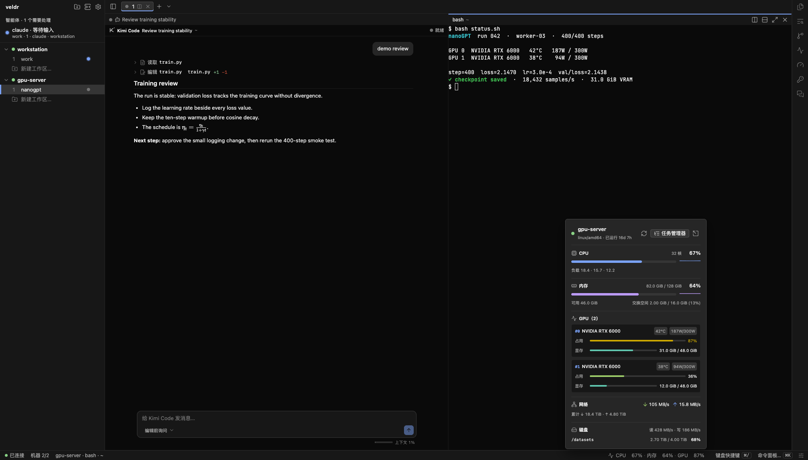

# herdr-ide

[English](README.md) | 简体中文

基于 [herdr-core](https://github.com/herdrdev/herdr-core) 终端核心的 Web IDE，以终端为中心，支持多台机器，围绕 agent 工作流设计：在一个浏览器标签页里使用所有机器上的 workspace 和终端，VS Code（code-server）点一下就能打开。

> 英文版 README 为主版本，本文与其保持相同的章节结构。
> 参数、快捷键等参考资料统一维护在英文文档 [docs/reference.md](docs/reference.md) 中。



## 功能

- **浏览器里的终端**：程序运行在每台机器的终端核心（herdr-core）里；
  浏览器用编译成 WebAssembly 的 Ghostty 终端库自己模拟每个终端，并用 WebGL 绘制（不支持时用 Canvas 2D）。
  按键按窗格里程序的模式编码（包括 kitty 键盘协议）。
  支持鼠标、滚动回看（拖到边缘会自动滚动，复制整段）、中文输入法、OSC 52 复制（在 Claude Code 里选中的文字直接进剪贴板）和拖动调整分屏，程序看到的终端颜色与界面主题一致。
  工作区、标签页和分屏是保存在每台机器上的布局文档，所有浏览器和桌面应用看到的都一样。
  拖动窗格标题栏可交换或移动窗格；
  双击标签页、工作区、窗格标题或机器名即可就地重命名；
  工作区菜单里的「编辑工作区」可修改名称和文件夹，文件夹留空时新终端在当前焦点窗格的文件夹中启动；
  把窗格拖到侧栏的另一个工作区上，或用窗格菜单的「移动到工作区」，即可把它移过去；
  拖动侧栏边缘或分屏分隔线可调整大小（双击恢复默认宽度或平分）；
  每个标签页都有关闭按钮，中键点击也能关闭；
  把标签页拖到另一个标签页的窗格上即可与它分屏拼在一起（像 Edge 的分屏，终端、VS Code 和插件窗格都可以）；
  拖动标签页、工作区和机器可调整顺序；
  右键窗格标题栏、标签页、工作区或机器可打开对应的命令菜单，右键窗格里的文字可复制、粘贴或打开路径。
  所有功能都能用鼠标完成；
  默认快捷键很少，不占用终端里程序要用的按键（`ctrl+b` 会直接发给 tmux），所有快捷键都可以在设置中绑定。
- **自带终端核心**：程序内置 Linux/macOS × amd64/arm64 的 herdr-core，第一次显示某台机器的终端时自动装到那台机器上；
  机器上不需要预先安装任何东西，也不需要外网。
  关闭浏览器或停止 core 后，程序继续运行。
  机器的右键菜单里有 **故障排除** ▸ **重启终端服务…**（程序继续运行）、**启动终端服务** 和 **停止终端服务…**。
- **多机器**：自己保存 SSH 机器列表（第一次启动时导入 herdr 中保存的机器）。
  在侧栏空白处右键可以添加机器（从列表中选择 `~/.ssh/config` 里的主机，或填写任意 ssh 目标，再填名称；需要密码或确认主机指纹时会在终端里询问），右键机器可以重命名、移除、禁用或启用它，或打开它的 **机器设置…**。
  每台机器只开一条 ssh 连接，在上面运行一个自动上传的静态 agent（linux/macOS × amd64/arm64），所有通信都在这条连接里多路复用；
  机器上不监听任何端口。
- **为 agent 设计**：
  - 汇总所有机器上 blocked 和 done 的 agent，agent 需要输入或完成时发浏览器通知并播放提示音；
  - 可以从命令面板新建 agent；
  - 可以从 VS Code 把代码发给所在工作区的 agent；
  - 可以把图片直接粘贴进 agent 的输入框；
  - 每台机器的 agent 会用 herdr 的规则识别终端里正在运行的编程 agent（Claude Code、Codex、Gemini、OpenCode 等），以及它是在工作、等待确认还是完成了一轮。
- **按需打开 VS Code**：
  - code-server 默认由本机下载后推送到各机器，机器本身不需要外网；
    也可以让机器自行下载，或直接使用机器上已安装的 code-server。
    会一并装好 Git Graph 和桥接扩展。
  - VS Code 和终端一样是一个窗格：「在 VS Code 中打开」（窗格标题栏上的按钮、窗格的右键菜单、命令面板，桌面应用里按 `cmd+j`）会把文件夹作为新标签页打开；
    窗格的 Diff 和 Git Graph 会在它旁边的 VS Code 里打开；
    终端里的 `path:line` 会在工作区的 VS Code 窗格里打开，没有时在终端旁边新开一个。
  - VS Code 窗格可以分屏、拖到其他标签页、最大化，重启后仍然保留；
    移动窗格或切换标签页都不会重新加载 VS Code。
  - 长时间不用的 code-server 会自动停止。
- **程序窗口**：远端 Linux 机器上程序打开的窗口（matplotlib、MuJoCo 查看器、Qt 工具等）会以浏览器窗口的形式出现，一个程序窗口对应一个浏览器窗口，支持鼠标和键盘。
  终端会自动获得虚拟显示（之前打开的 shell 可以从它的菜单补上）；
  机器上没有 Xvfb 时会以普通用户身份获取，无需 root；
  装有 VirtualGL 的机器可用 GPU 渲染 OpenGL。
  持续变化的窗口以视频传输给能解码的浏览器（NVIDIA、Intel、AMD 显卡上用 H.264，否则用 VP8），静止的窗口以精确的图片传输。
- **快速查看**：在终端里 ⌘/Ctrl+点击或右键路径（折成多行的长路径也可以），即可在预览窗格里预览图片、GIF、视频（可拖动进度）、音频、PDF、文本和目录。
- **公式**：鼠标停在窗格里 agent 写的 LaTeX 公式上（`$…$`、`$$…$$`、`\(…\)`、`\[…\]`，包括被 markdown 渲染吃掉反斜杠的写法），即可看到排版后的公式，并可复制源码。
- **查找**：按 ⌘F（其他系统为 Ctrl+Shift+F）可在窗格的输出里查找文字，包括滚动回看的内容。
  屏幕上的所有匹配都会高亮，Enter 和 Shift+Enter 分别跳到更早和更新的匹配，并自动滚动到可见位置。
- **把文件交给 agent**：把文件粘贴或拖到窗格里，即可粘贴它们的路径；
  不在该窗格所在机器上的文件会先上传过去，拖入的文件放进窗格当前所在的目录（不会覆盖已有文件）。
  状态栏的上传面板显示每个上传的进度和速度，可以取消上传，也能查看最近的上传记录。
- **从机器下载文件**：在窗格里右键即可下载鼠标下的路径，也可以在窗格当前目录里勾选多个文件和文件夹一起下载；
  文件夹打包成 zip，从机器上边打包边下载。
  VS Code 的资源管理器里也有同样的下载。
  状态栏的下载面板显示每个下载的进度、速度和结果，可以取消或重新下载。
- **多浏览器同时使用**：所有浏览器和桌面应用看到同样的终端，都可以输入；终端的尺寸由最近使用它的一方决定。
- **插件与右侧栏**：以插件形式提供的功能会在右侧栏添加面板（桌面应用在 macOS 上按 ⌘⌥B），还可以添加自己的窗格、命令和状态栏项目。
  每个插件都可以在“设置 › 插件”中关闭。
  上传和下载、程序窗口和 VS Code 也是插件（关闭 VS Code 后不会再下载或启动 code-server）。
- **文件资源管理器**：右侧栏里机器上文件的树（桌面应用在 macOS 上按 ⌘⇧E），跟随当前终端的目录，用法与 VS Code 的资源管理器一样：筛选、隐藏文件、键盘操作、新建文件和文件夹、重命名、剪切/复制/粘贴、拖动移动、从电脑拖入文件即上传、移到废纸篓、复制路径、下载、在终端或 VS Code 中打开。
  与 VS Code 一样，单击在预览编辑器中显示文件（再单击另一个文件会替换它），双击则保持打开；文本用 Monaco 编辑，图片、视频和 PDF 按快速查看的方式显示；保存时绝不会覆盖打开后在机器上发生的修改。
  有改动的文件按 Git 状态着色，编辑器的行号旁标出改动的行。
- **Git**：不用 VS Code 也有 VS Code 的源代码管理和 Git Graph，作用于当前窗格所在的仓库，任何机器都可以。
  面板（桌面应用中按 Ctrl+Shift+G）显示分支、领先/落后的提交数，可以抓取、拉取和推送，以列表或树形列出已暂存和未暂存的更改，提交（⌘/Ctrl+Enter，可修改上次提交）并管理储藏；面板底部停靠着完整的提交历史和分支图，可以一直向下滚动查看所有提交，点击提交即可展开它改动的文件。
  Git 图窗格显示泳道、分支和标签徽标，支持搜索、按分支筛选、查看提交的文件，右键菜单可检出、建分支和标签、合并、变基、拣选、还原、重置。
  差异在 Monaco 中并排或内联显示，可以暂存、取消暂存或放弃所选范围，工作区一侧可直接编辑。
  文件资源管理器里会为更改的文件着色（[31](docs/features/31-git.md)）。
- **变量库**：API 密钥等环境变量用由主口令生成的密钥加密，保存在 core 所在电脑上，供各机器上的编程智能体使用。
  批准请求、显示值和修改变量都要经过同一道闸门——主口令，所以任何程序（包括 core 所在电脑上的程序）都无法绕过你拿到值。
  Claude Code、Codex 等 MCP 客户端通过变量库的 MCP 服务器读取，面板里有每台机器的接入指南。
  每个变量可指定无需询问即可读取的机器；其他机器的请求会在所有页面上弹窗（允许一次、始终允许、拒绝）。
  `run_with_env` 带着变量运行命令，不让模型看到变量值（[30](docs/features/30-variable-vault.md)）。
- **AI 用量**：右侧栏的面板和状态栏项目显示各机器上已登录的 AI 订阅还剩多少，支持 Claude、Codex、Grok、Antigravity、Kimi Code 和 DeepSeek。
  布局参照 CodexBar：每个服务一个带图标和配色的磁贴，概览页显示按 API 价格折算的本地日志费用（按天、模型、项目和机器），每个服务还有自己的详情页。
  每个时间窗口显示用量、重置倒计时以及按当前速度是否会提前用尽，另有额度与余额、各家状态页的故障提示。
  同一账号出现在多台机器上时只显示一张卡片；用量达到所设阈值时发出通知。
  “费用”页把各 CLI 本地日志按 API 价格折算，按天、模型、项目和机器汇总。
  凭据在所在机器上只读读取，从不离开那台机器。
- **设置**：界面语言（中文、英文）、浅色/深色主题（VS Code 同步切换）、颜色主题（强调色：蓝、VS Code 蓝、青绿、紫、玫红、琥珀、石墨）、界面大小、桌面应用的界面缩放、终端的字体（从已安装的等宽字体中选择，带预览）、行高、光标、回滚行数、响铃、配色方案（Dracula、Nord、Solarized、One、Gruvbox、Tomorrow 等）及自定义颜色、提示音/系统通知/程序坞与任务栏角标各自开关、静音的智能体、每台机器获取 VS Code 的方式、每台机器的程序窗口以及所有快捷键，集中在一个与 VS Code 布局相同、可搜索的设置对话框里（侧栏的齿轮按钮，桌面应用里按 `cmd+,` 或 `ctrl+,`；机器的右键菜单可打开它自己的设置）。
  设置和快捷键保存在 core 所在主机上的两个 JSON 文件里，也可以直接手改；浏览器和桌面应用看到的都一样。
  终端默认使用内置的 JetBrains Mono 字体，也可以换成其他字体。

## 截图

**VS Code 就在终端旁边**：agent 输出里的 `路径:行号` 会在窗格所在机器的 VS Code 里打开；
窗格标题栏上的按钮可以打开它的文件夹、diff 或 Git Graph。


**程序窗口**：远端 Linux 机器上 matplotlib 打开的窗口，会出现在单独的浏览器窗口里，支持鼠标和键盘。


**快速查看**：在终端里右键或 ⌘/Ctrl+点击路径即可预览；
用箭头可以翻看同一目录下的其他文件。


## 快速开始

需要：

- 能正常连到要使用的机器的 OpenSSH 客户端（只用本机时不需要）；
- 构建需要：Go（版本见 `go.mod`）、Node.js 22.12+ 和 pnpm（`corepack enable` 会使用固定的版本）。

```bash
make deps && make build
cd dist/packages/herdr-ide-$(go env GOOS)-$(go env GOARCH)
./herdr-ide
```

也可以解压 `dist/release/` 或 GitHub Releases 中对应平台的压缩包，运行 `./herdr-ide`。
SSH 机器用侧栏的「添加机器…」添加。
从使用 herdr 绘制窗格的旧版本升级时，设置、快捷键和机器会在第一次启动时迁移过来，终端仍留在 herdr 里（见[迁移说明](docs/deployment.md#migrating-from-versions-that-used-herdr)）。

打开 <http://127.0.0.1:7780>。
状态栏可以打开命令面板和快捷键列表（macOS 上的浏览器里分别是 `cmd+k` 和 `cmd+/`，其他系统的浏览器里按 `ctrl+shift+/` 查看快捷键）。
全部参数见 [docs/reference.md](docs/reference.md)。

## 桌面应用

同一套界面也提供 Electron 桌面应用，自带一个 core（`http://127.0.0.1:7781`，instance 为 `desktop`），支持 macOS、Windows 和 Linux。
可从 GitHub Releases 下载：

| | macOS | Windows | Linux |
| --- | --- | --- | --- |
| 安装包 | `…-mac-arm64.dmg`（Apple Silicon）、`…-mac-x64.dmg`（Intel），另有 `.zip` | `…-win-x64.exe`，为当前用户安装（无需管理员权限） | `…-linux-amd64.deb`、`…-linux-arm64.deb`、`…-linux-x86_64.AppImage`、`…-linux-arm64.AppImage` |
| 签名 | ad-hoc 签名；发布时配置了 Developer ID 则正式签名并经过公证 | 无 | 无 |
| 本机终端 | 支持 | 不支持：本机需要 Linux 或 macOS | 支持 |
| SSH 机器 | 支持 | 支持，需使用密钥认证 | 支持 |
| VS Code | 所有机器 | SSH 机器 | 所有机器 |
| 程序窗口 | 来自远端 Linux 机器 | 来自远端 Linux 机器 | 来自远端 Linux 机器 |
| 通知 | 支持，Dock 图标上显示角标 | 支持，任务栏按钮上显示叠加图标 | 需要通知守护进程（桌面环境都自带） |

- **macOS**：把 DMG 里的应用拖入 Applications。
  如果 macOS 提示无法检查该应用是否包含恶意软件，按住 Control 点按应用并选择「打开」（macOS 15 及以后：在“系统设置 → 隐私与安全性”中选择「仍要打开」）。
  关闭窗口后应用仍留在 Dock 中，直到退出。
  要让终端和文件浏览器读取其他应用的数据（邮件、信息、Safari 浏览器），并且不经询问就能打开桌面、文稿、下载或外置磁盘，请在「设置 → 终端 → 权限」中授予完全磁盘访问权限：它会打开系统设置，在那里打开 herdr-ide 并添加运行终端的 herdr-core，然后告诉你需要重启什么。
  采用临时签名（ad hoc）的应用每次重新构建或更新后都需要重新授予。
- **Windows**：运行安装程序；如果 SmartScreen 提示“Windows 已保护你的电脑”，点「更多信息」→「仍要运行」。
  需要 Windows 的 OpenSSH 客户端（Windows 10 1809 及以后默认已安装）。
  应用只能使用 SSH 机器：先在终端里用 `ssh <目标>` 连接每台机器一次以接受主机密钥，并使用 ssh agent 持有的密钥（`ssh-add`），因为应用无法询问密码。
  没有内置 WSL 支持；运行 ssh 服务的 WSL 发行版可以作为 SSH 机器添加。
- **Linux**：`sudo apt install ./herdr-ide-<version>-linux-amd64.deb`（Ubuntu 24.04 及以后需要用 deb 包，它让 Chromium 的沙箱能够运行）。
  AppImage 需要先 `chmod +x`，并需要 FUSE 2（`libfuse2`，Ubuntu 24.04 上为 `libfuse2t64`）。

没有自动更新：把新版本安装到旧版本上即可。
也可以在当前系统上自行打包，内含同一套 core、Web UI、agent 和 VS Code 桥接扩展：

```bash
make desktop-app                 # 未打包的应用，位于 dist/desktop/
make desktop-dist                # 当前系统的安装包：DMG 和 zip、安装程序，或 AppImage 和 deb
make desktop-install             # macOS：.app，并复制到 /Applications
ARCH=x64 make desktop-dist       # 其他架构；默认使用当前 Node 的架构
```

从文件管理器把文件夹拖到侧栏、在 macOS 上拖到 Dock 图标，或在 Linux 上用「打开方式」以本应用打开，即可在本机为每个文件夹新建一个工作区。
拖到本机窗格上的文件和文件夹直接粘贴原路径，不会上传。

在 macOS 上，`cmd+t` 新建标签页，`cmd+1`…`cmd+9` 切换标签页（`cmd+9` 为最后一个），`cmd+shift+w` 关闭标签页，`cmd+w` 关闭窗格（工作区里已没有标签页时关闭工作区），`cmd+d` / `cmd+shift+d` 分屏，`cmd+alt+方向键` 在窗格间移动，`cmd+[` / `cmd+]` 在聚焦过的窗格间后退和前进，`cmd+z` 在 5 秒内撤销关闭（还是原来的终端，程序仍在运行），`cmd+shift+enter` 最大化窗格，`cmd+n` 新建工作区，`cmd+,` 打开设置，`cmd+shift+p` 打开命令面板，`cmd+j` 在 VS Code 中打开当前窗格的文件夹，`cmd++`、`cmd+-` 和 `cmd+0` 缩放窗口（终端一起缩放）。
在 Windows 和 Linux 上，`ctrl+shift+t` 新建标签页，`ctrl+tab` 和 `alt+1`…`alt+9` 切换标签页，`ctrl+shift+w` 关闭标签页，`ctrl+shift+n` 新建工作区，`ctrl+,` 打开设置，`ctrl+shift+p` 打开命令面板，`ctrl+shift+j` 在 VS Code 中打开，`ctrl++`、`ctrl+-` 和 `ctrl+0` 缩放窗口；
其他按键（包括 `ctrl+c` 和 `ctrl+q`）都会发给终端。
焦点在 VS Code 里时，VS Code 自己的快捷键优先（`cmd+j` 会切换它自己的底部面板），只有 macOS 上的 `cmd+w` 例外，它会关闭 VS Code 窗格。
菜单栏显示当前生效的快捷键，使用界面的语言；
标题栏跟随界面的主题。
可在**设置 → 键盘快捷键**中修改或移除快捷键，也可以绑定 `ctrl+b c` 这样的组合键；
浏览器里 `cmd+t` / `cmd+w` 仍归浏览器自己使用。

退出应用时会回收它的 core；各机器上的终端继续运行。
仍需预先安装 OpenSSH。
版本号、数据目录和隔离开发方式见[桌面部署说明](docs/deployment.md#desktop-app)。

## 远程访问

herdr-ide 本身不带登录：让它只监听 `127.0.0.1`，前面放一个负责登录和 HTTPS 的反向代理（Tailscale、Caddy、nginx），再用 `--allowed-origin` 告诉它代理的对外地址。
另外还有几项可选的安全围栏：反代密钥头、只读模式、审计日志。
详见 [docs/deployment.md](docs/deployment.md) 和 [SECURITY.md](SECURITY.md)。

## 离线（air-gap）环境

各台机器永远不需要下载任何东西。
（AI 用量插件会从已登录 CLI 的机器上访问各 AI 服务商的主机；没有网络时它会静默失败。）
如果运行 herdr-ide 的主机也不能联网：
1. 在一台能联网的机器上运行 `herdr-ide fetch-assets DIR`；
2. 把 `DIR` 拷进内网；
3. 用 `--offline --seed-dir DIR` 启动。

所有下载都会用写死在代码里的 SHA-256 校验。
详见 [docs/deployment.md](docs/deployment.md#air-gapped-networks)。

## 文档

- [docs/reference.md](docs/reference.md)：参数、快捷键、环境变量、文件位置
- [docs/deployment.md](docs/deployment.md)：反向代理、离线安装、远程资源、作为服务运行
- [docs/architecture.md](docs/architecture.md)：组件与协议
- [docs/features/](docs/features/README.md)：每个功能一篇设计文档，包括考虑过的方案与取舍
- [SECURITY.md](SECURITY.md)：威胁模型与漏洞报告

## 开发

```bash
make dev-core      # 在 :7790 以 --instance dev 运行 core（终端核心 session 为 herdr-ide-dev）
make dev-web       # 前端热更新，端口 5173
make check test    # 提交 PR 之前运行
```

见 [CONTRIBUTING.md](CONTRIBUTING.md)；
编码 agent 请先读 [AGENTS.md](AGENTS.md)。

## 参与贡献

欢迎用中文或英文提 issue 和 PR，请先阅读 [CONTRIBUTING.md](CONTRIBUTING.md) 和[行为准则](CODE_OF_CONDUCT.md)。

## 许可证

[MIT](LICENSE)。
第三方许可证：Go 依赖见 [THIRD_PARTY_NOTICES.md](THIRD_PARTY_NOTICES.md)，前端打包的依赖（包括 Ghostty 的终端库（MIT）、KaTeX 和 JetBrains Mono 字体）见程序提供的 `/licenses.md`。
核心程序内嵌供各机器使用的 [herdr-core](https://github.com/herdrdev/herdr-core)（Apache-2.0），其许可证及依赖声明在发布包的 `licenses/herdr-core/` 中。
agent 中带有 herdr 的 agent 识别规则（Apache-2.0，见 [licenses/herdr-detect/](licenses/herdr-detect/)）。
核心程序还内嵌供 Linux 机器使用的视频编码器（FFmpeg，LGPL-2.1，以及 libvpx、libva 和 libdrm；见 [licenses/encoder/](licenses/encoder/)）。
code-server 和 Git Graph 使用各自的许可证，在运行时下载。
Git Graph 明确限制衍生作品分发，对原版的一般再分发授权不明确，因此不纳入公开发布包。
