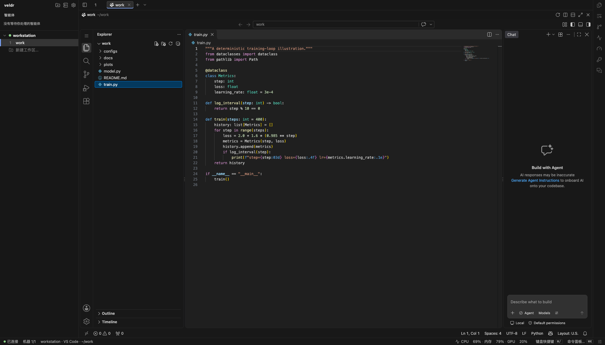
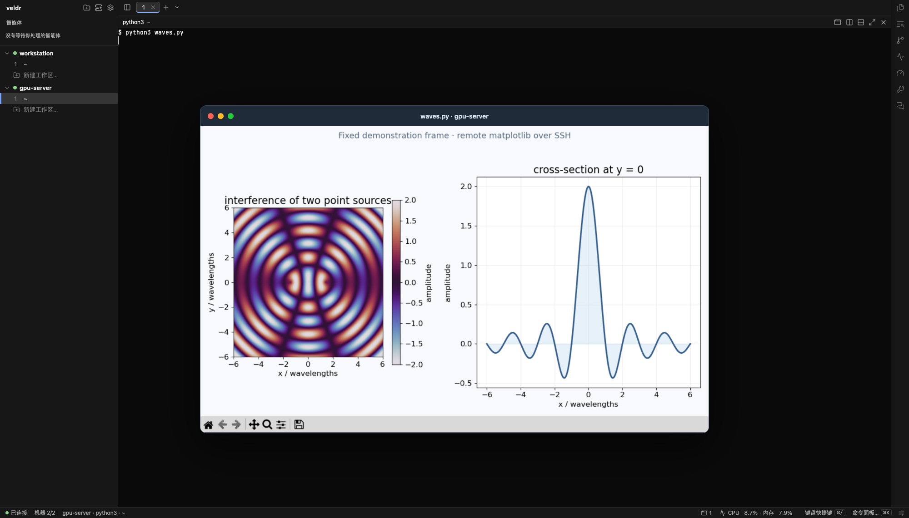

# herdr-ide

[English](README.md) | 简体中文

基于 [herdr](https://herdr.dev) 终端核心的 Web IDE，以终端为中心，支持多台机器，围绕 agent 工作流设计：在一个浏览器标签页里使用所有机器上的 workspace 和终端，VS Code（code-server）一个快捷键就能打开。

> 英文版 README 为主版本，本文与其保持相同的章节结构。
> 参数、快捷键等参考资料统一维护在英文文档 [docs/reference.md](docs/reference.md) 中。


## 功能

- **浏览器里的终端**：程序运行在每台机器的终端核心（herdr-core）里；
  浏览器用编译成 WebAssembly 的 Ghostty 终端库自己模拟每个终端，并用 WebGL 绘制（不支持时用 Canvas 2D）。
  按键按 pane 里程序的模式编码（包括 kitty 键盘协议）。
  支持鼠标、滚动回看（拖到边缘会自动滚动，复制整段）、中文输入法、OSC 52 复制（在 Claude Code 里选中的文字直接进剪贴板）和拖动调整分屏，程序看到的终端颜色与界面主题一致。
  workspace、tab 和分屏是保存在每台机器上的布局文档，所有浏览器、桌面应用和 macOS 应用看到的都一样。
  拖动 pane 标题栏可交换或移动 pane，点击标题即可重命名；
  拖动 tab 和 workspace 可调整顺序；
  右键 pane 标题栏、tab 或 workspace 可打开对应的命令菜单，右键 pane 里的文字可复制、粘贴或打开路径。
  快捷键使用前缀 `ctrl+b`，可在设置中修改。
- **自带终端核心**：程序内置 Linux/macOS × amd64/arm64 的 herdr-core，第一次显示某台机器的终端时自动装到那台机器上；
  机器上不需要 herdr，也不需要外网。
  关闭浏览器或停止 core 后，程序继续运行。
  右键机器可以 **启动终端核心**、**重启终端核心**（程序继续运行）或 **停止终端核心**。
- **多机器**：自己保存 SSH 机器列表（第一次启动时导入 herdr 中保存的机器）。
  在侧栏空白处右键可以添加机器（填写 ssh 目标和名称，需要密码或确认主机指纹时会在终端里询问），右键机器可以重命名、移除、禁用或启用它。
  每台机器只开一条 ssh 连接，在上面运行一个自动上传的静态 agent（linux/macOS × amd64/arm64），所有通信都在这条连接里多路复用；
  机器上不监听任何端口。
- **为 agent 设计**：
  - 汇总所有机器上 blocked 和 done 的 agent，agent 需要输入或完成时发浏览器通知并播放提示音；
  - 可以从命令面板新建 agent；
  - 可以从 VS Code 把代码发给当前聚焦的 agent；
  - 可以把图片直接粘贴进 agent 的输入框；
  - 每台机器的 agent 会用 herdr 的规则识别终端里正在运行的编程 agent（Claude Code、Codex、Gemini、OpenCode 等），以及它是在工作、等待确认还是完成了一轮。
- **按需打开 VS Code**：
  - code-server 默认由本机下载后推送到各机器，机器本身不需要外网；
    也可以让机器自行下载，或直接使用机器上已安装的 code-server。
    会一并装好 Git Graph 和桥接扩展。
  - 一个快捷键或 pane 标题栏里的按钮就能打开 pane 所在的目录、它的 Diff 或 Git Graph；
    终端里的 `path:line` 可以直接跳到编辑器。
  - 每个 workspace 有自己的 VS Code 面板，可以同时开着多个 VS Code，切换 workspace 就切换到对应的那个。
  - 面板可以放在终端右侧或下方。
  - 长时间不用的 code-server 会自动停止。
- **程序窗口**：远端 Linux 机器上程序打开的窗口（matplotlib、MuJoCo 查看器、Qt 工具等）会以浏览器窗口的形式出现，一个程序窗口对应一个浏览器窗口，支持鼠标和键盘。
  pane 和终端会自动获得虚拟显示（之前打开的 shell 可以从它的菜单补上）；
  机器上没有 Xvfb 时会以普通用户身份获取，无需 root；
  装有 VirtualGL 的机器可用 GPU 渲染 OpenGL。
  持续变化的窗口以视频传输给能解码的浏览器（NVIDIA、Intel、AMD 显卡上用 H.264，否则用 VP8），静止的窗口以精确的图片传输。
- **快速预览**：在终端里 ⌘/Ctrl+点击或右键路径（折成多行的长路径也可以），即可预览图片、GIF、视频（可拖动进度）、音频、PDF、文本和目录。
- **公式**：鼠标停在 pane 里 agent 写的 LaTeX 公式上（`$…$`、`$$…$$`、`\(…\)`、`\[…\]`，包括被 markdown 渲染吃掉反斜杠的写法），即可看到排版后的公式，并可复制源码。
- **查找**：按 ⌘F（其他系统为 Ctrl+Shift+F）可在 pane 的输出里查找文字，包括滚动回看的内容。
  屏幕上的所有匹配都会高亮，Enter 和 Shift+Enter 分别跳到更早和更新的匹配，并自动滚动到可见位置。
- **把文件交给 agent**：把文件粘贴或拖到 pane 里，即可粘贴它们的路径；
  不在该 pane 所在机器上的文件会先上传过去，拖入的文件放进 pane 当前所在的目录（不会覆盖已有文件）。
  状态栏的上传面板显示每个上传的进度和速度，可以取消上传，也能查看最近的上传记录。
- **从机器下载文件**：在 pane 里右键即可下载鼠标下的路径，也可以在 pane 当前目录里勾选多个文件和文件夹一起下载；
  文件夹打包成 zip，从机器上边打包边下载。
  VS Code 的资源管理器里也有同样的下载。
  状态栏的下载面板显示每个下载的进度、速度和结果，可以取消或重新下载。
- **多浏览器同时使用**：所有浏览器、桌面应用和 macOS 应用看到同样的终端，都可以输入；终端的尺寸由最近使用它的一方决定。
- **设置**：界面语言（中文、英文）、浅色/深色主题（VS Code 同步切换）、界面大小、终端的字体、行高、光标、回滚行数、响铃和配色（两种主题的 16 色），面板位置、code-server 安装方式以及所有快捷键，集中在一个可搜索的设置对话框里（`ctrl+b ,`）。
  设置和快捷键保存在 core 所在主机上的两个 JSON 文件里，也可以直接手改；浏览器、桌面应用和 macOS 应用看到的都一样。
  终端默认使用内置的 JetBrains Mono 字体，也可以换成其他字体。
  终端在任何浏览器里都使用内置的 JetBrains Mono 字体。

## 截图

**VS Code 就在终端旁边**：agent 输出里的 `路径:行号` 会在 pane 所在机器的 VS Code 里打开；
pane 标题栏上的按钮可以打开它的文件夹、diff 或 Git Graph。



**程序窗口**：远端 Linux 机器上 matplotlib 打开的窗口，会出现在单独的浏览器窗口里，支持鼠标和键盘。



**快速预览**：在终端里右键或 ⌘/Ctrl+点击路径即可预览；
用箭头可以翻看同一目录下的其他文件。


## 快速开始

需要：

- 能正常连到要使用的机器的 OpenSSH 客户端（只用本机时不需要）；
- 构建需要：Go（版本见 `go.mod`）、Node.js 22.12+ 和 pnpm（`corepack enable` 会使用固定的版本）。

```bash
make deps && make build
cd dist/packages/herdr-ide-$(go env GOOS)-$(go env GOARCH)
./herdr-ide
```

也可以解压 `dist/release/` 或 GitHub Releases 中对应平台的压缩包，运行 `./herdr-ide`；
请保持目录完整。
本机没装 herdr 时，用 `./herdr-ide herdr [参数]` 运行自带的 herdr，例如 `./herdr-ide herdr` 打开它的 TUI（同时启动本地 herdr server）。
SSH 机器用侧栏的「添加机器…」添加。

打开 <http://127.0.0.1:7780>。
`ctrl+b space` 打开命令面板，`ctrl+b ?` 查看快捷键。
全部参数见 [docs/reference.md](docs/reference.md)。

## macOS 桌面应用

在 macOS 上，可从 GitHub Releases 下载对应的 DMG（Apple Silicon 用 `…-mac-arm64.dmg`，Intel 用 `…-mac-x64.dmg`），把应用拖入 Applications。
应用未经 Apple 公证，首次启动需在“系统设置 → 隐私与安全性”中允许。
也可以自行将同一套 core、Web UI、agent 和 VS Code 桥接扩展打包为 Electron 应用：

```bash
make desktop-app                 # .app 位于 dist/desktop/mac[-arm64]/
make desktop-dmg                 # .app 和可拖入 Applications 安装的 .dmg
make desktop-install             # .app，并复制到 /Applications
ARCH=x64 make desktop-dmg        # Intel；默认使用当前 Node 的架构
```

桌面版与浏览器使用统一的终端窗格图标；
macOS 版包含适用于 Finder 和 Dock 的多尺寸图标。

从 Finder 把文件夹拖到侧边栏或应用的 Dock 图标上，即可在本机为每个文件夹新建一个 workspace。
拖到本机 pane 上的文件和文件夹直接粘贴原路径，不会上传。

在桌面应用中，`cmd+t` 新建标签页，`cmd+w` 关闭 pane，`cmd+d` / `cmd+shift+d` 分屏，`cmd+n` 新建 workspace，`cmd+,` 打开设置，`cmd+j` 显示或隐藏 VS Code 面板；
焦点在 VS Code 里时，除 `cmd+j` 外这些键仍归 VS Code。
可在**设置 → 快捷键**中修改或移除。
前缀快捷键仍然可用；
浏览器中 `cmd+t` / `cmd+w` 仍归浏览器所有。

应用会以 `desktop` instance 启动自己的 core，监听 `http://127.0.0.1:7781`；
退出应用或关闭主窗口时回收该 core。
应用自带 herdr，本机没装 herdr 时使用它；
仍需预先安装 OpenSSH。
发布版和本地构建都使用 ad-hoc 签名，不含 Apple 公证或自动更新。
版本号、数据目录和隔离开发方式见[桌面部署说明](docs/deployment.md#macos-desktop-app)。
目前仅实现 macOS 打包。

## 远程访问

herdr-ide 本身不带登录：让它只监听 `127.0.0.1`，前面放一个负责登录和 HTTPS 的反向代理（Tailscale、Caddy、nginx），再用 `--allowed-origin` 告诉它代理的对外地址。
另外还有几项可选的安全围栏：反代密钥头、只读模式、审计日志。
详见 [docs/deployment.md](docs/deployment.md) 和 [SECURITY.md](SECURITY.md)。

## 离线（air-gap）环境

各台机器永远不需要下载任何东西。
如果运行 herdr-ide 的主机也不能联网：
1. 在一台能联网的机器上运行 `herdr-ide fetch-assets DIR`；
2. 把 `DIR` 拷进内网；
3. 用 `--offline --seed-dir DIR` 启动。

所有下载都会用写死在代码里的 SHA-256 校验。
详见 [docs/deployment.md](docs/deployment.md#air-gapped-networks)。

## 文档

- [docs/reference.md](docs/reference.md)：参数、快捷键、环境变量、文件位置
- [docs/deployment.md](docs/deployment.md)：反向代理、离线安装、远程资源、作为服务运行
- [docs/architecture.md](docs/architecture.md)：组件与协议
- [docs/features/](docs/features/README.md)：每个功能一篇设计文档，包括考虑过的方案与取舍
- [SECURITY.md](SECURITY.md)：威胁模型与漏洞报告

## 开发

```bash
herdr --session herdr-ide-dev server &   # 隔离的 herdr session
make dev-core                            # 在 :7790 以 --instance dev 运行 core
make dev-web                             # 前端热更新，端口 5173
make check test                          # 提交 PR 之前运行
```

见 [CONTRIBUTING.md](CONTRIBUTING.md)；
编码 agent 请先读 [AGENTS.md](AGENTS.md)。

## 参与贡献

欢迎用中文或英文提 issue 和 PR，请先阅读 [CONTRIBUTING.md](CONTRIBUTING.md) 和[行为准则](CODE_OF_CONDUCT.md)。

## 许可证

[MIT](LICENSE)。
第三方许可证：Go 依赖见 [THIRD_PARTY_NOTICES.md](THIRD_PARTY_NOTICES.md)，前端打包的依赖见程序提供的 `/licenses.md`。
附带的 herdr 使用 Apache-2.0，其许可证及依赖声明见 [licenses/herdr/](licenses/herdr/)。
核心程序内嵌供各机器使用的 [herdr-core](https://github.com/herdrdev/herdr-core)（Apache-2.0），其许可证及依赖声明在发布包的 `licenses/herdr-core/` 中。
code-server 和 Git Graph 使用各自的许可证，在运行时下载。
Git Graph 明确限制衍生作品分发，对原版的一般再分发授权不明确，因此不纳入公开发布包。
